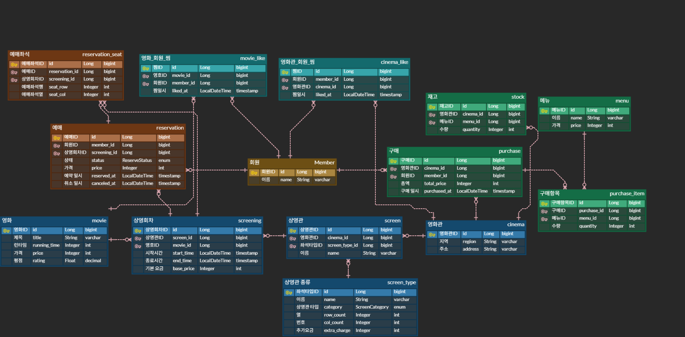
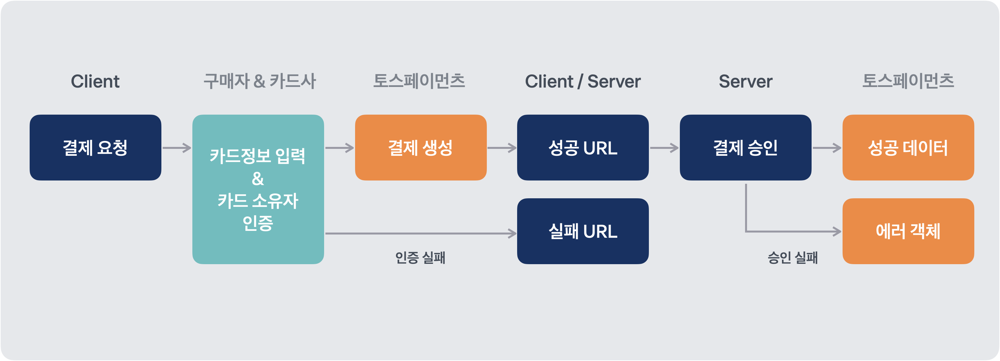

# spring-cgv-24th
**CEOS 24기 백엔드 스터디 - CGV 클론 코딩 프로젝트**

## 2주차 DB 모델링
<details>
<summary>CGV DB 모델링</summary>
<div markdown="1">

### 요구사항

```
1. 영화관 조회
2. 영화관 찜
3. 영화 조회
4. 영화 예매, 취소
5. 영화 찜
6. 매점 구매 (환불X)
- 기타 기능 설명
    - 모든 영화관에 특별관과 일반관이 존재해요
    - 특별관, 일반관 종류가 같다면 좌석은 동일해요
    - 좌석은 직사각형 형태로 존재해요 (중간에 비어있는 곳 없음, 통로 고려X)
    - 영화관마다 매점이 있으며 재고를 따로 관리해요 (재고는 항상 1 이상이에요)
    - 모든 영화관의 매점 메뉴는 같아요
```


### **회원 도메인 - `Member`**

모든 행위의 주체입니다. 예매, 구매, 찜  3개의 도메인이 전부 회원 테이블과 연관관계(1:N)를 가집니다. 추후 이메일, 소셜 UUID 등 컬럼을 추가할 예정입니다.

### **영화 도메인 - `Movie`, `Cinema`, `Screen`, `ScreenType`, `Screening`**

영화와 영화관의 M:N 관계를 풀기 위해 중간에 Screen(상영관), Screening(상영회차) 중간 테이블을 두었습니다.

최종적으로 **영화 -1:N - 상영회차 - N:1 - 상영관 -N:1 - 영화관** 구조를 설계했습니다.

**`Screening` 테이블**: 하나의 영화는 여러 상영관에서 상영될 수 있고, 하나의 상영관을 여러 영화가 상영될 수 있으므로 중간 테이블을 두어 N:M 관계를 해소하고자 하였습니다.

`SceenType` **테이블**: “종류가 같다면 좌석을 동일하다” → 좌석 배치가 개별 상영관이 아니라 상영관 종류에 딸린 속성입니다. 그래서 좌석을 상영관 종류 안에 넣었습니다.

### **예매 도메인: `Reservation`, `Reservation_seat`**

예매는 영화가 아닌 상영회차를 기리킵니다. 상영회차만 알면, N:1의 흐름을 따라 영화, 상영관, 영화관 정보를 알 수 있습니다.

예매 좌석을 별도 테이블로 둔 이유는 개수입니다. 한 예매에 회원과 상영회차는 하나씩이지만 좌석은 2개를 사면 2개가 되어야합니다. 아래 상품 구매와 구매 항목 테이블 관계와 같습니다.

또한 상영 회차 테이블과의 관계를 따로 추가했습니다. 그 이유는 `(screeing_id, seat_id)` 유니크 제약을 걸기 위해서입니다.

상영회차 FK가 없을 경우에 만약 A(id=7)와 B(id=8)가 동시에 예매를 했다면,

예매좌석 (id=7, 회차=2, 좌석=I행 1열), 예매 (id=8, 회차=2, 좌석=I행 1열)

→ 같은 회차에 대해 중복 좌석이 예약된다.

### **상품 도메인: `Menu`, `Stock`, `Purchase`, `Purchase_item`**

“영화관마다 매점이 있으며 재고를 따로 관리해요” → 영화관:매점을 1:1 관계이지만, “모든 영화관의 메뉴는 같다”이므로 메뉴는 전역 테이블로 설정, 재고는 따로 테이블을 두었기 때문에, 매점 테이블에 남을 컬럼이 `id`와 `cinema_id` 뿐이다. 그래서 매점이라는 개념을 영화관 테이블에 흡수시켰습니다.

상품 구매를 `Purchase`와 `Purchase_item`으로 나눈 이유도 앞선 예매 좌석을 따로 만든 이유와 같습니다.

### **좋아요 도메인 - `Movie_like`, `Cinema_like`**

두 테이블 모두 (member_id, 대상_id) 유니크가 필요합니다. (중복 예방)

</div>
</details>

<details>
<summary>테스트 환경 세팅</summary>
<div markdown="1">

### 1. 테스트 환경을 H2 DB로 세팅

→ 장점: 속도가 빠르다.

→ 단점: 동시성 테스트를 진행하면 mySQL과 H2 실행결과가 다를 수 있다.

### 2. 그래서 mySQL 테스트 스키마를 생성

→ 장점: 실제 운영 테스트와 실행 결과가 같다.

→ 단점: .env 파일을 주입시켜야지 application-test.yaml이 환경변수를 읽을 수 있는데, 현재는 gradle 러너가 테스트를 주관하므로, 환경변수를 주입할 방법이 없다.

만약 Intellij 러너로 바꾸면 환경변수를 주입할 수는 있겠지만, 다른 사람이 CLI에서 gradle test를 진행할 경우에는 테스트가 불가하다.

### 3. gradle 러너에 .env 파일 주입

결국 mySQL 테스트 스키마를 생성하고, gradle 러너가 .env 환경변수를 읽을 수 있도록 build.gradle 파일에 다음과 같은 코드로 설정하여, .env를 읽을 수 있도록 했다.

```java
tasks.named('test') {
	useJUnitPlatform()

	// .env 값을 테스트 JVM 환경변수로 주입한다.
	def envFile = file('.env')
	if (envFile.exists()) {
		envFile.readLines().each { line ->
			def matcher = line =~ /^\s*([A-Za-z_][A-Za-z0-9_]*)\s*=\s*(.*?)\s*$/
			if (matcher.matches()) {
				environment matcher.group(1), matcher.group(2).replaceAll(/^["']|["']$/, '')
			}
		}
	}
}
```

### 4. 실행과 테스트 양쪽에서 동일하게 동작하는 방법

3번 방식까지는 결국, test 태스크에만 적용돼서 bootRun으로 띄울 때는 여전히 `.env`를 못읽고 IDE Run Configuration이나 쉘 export에 의존하게 된다. `.idea`는 gitignore에 있으니 새로 클론한 사람은 실행이 안 되는 상황이 생길 수 있다.

그래서 실행과 테스트 양쪽에서 동일하게 동작할 수 있게 하는 방법 2가지가 있다.

**1. spring.config.import**

스프링 부트가 직접 `.env`를 프로퍼티 소스로 읽게한다. Gradle, IDE, java -jar 환경에 관계없이 Spring이 뜨는 곳이면 어디서나 동작한다.

```yaml
# application.yml
spring:
  config:
    import: optional:file:.env[.properties]
  datasource:
    url: ${DB_URL}
    username: ${DB_USERNAME}
    password: ${DB_PASSWORD}
```

- `.env`는 확장자가 없어서 `[.properties]`로 “properties 형식(key:value)으로 읽어라”라고 알려줘야 한다.
- `optional:`을 붙여야 `.env`가 없는 운영 서버에서도 에러 없이 뜬다.

**2. `spring-dotenv` 라이브러리**

`.env`를 읽는 전용 라이브러리로, 의존성만 추가 하면된다.

**테스트는 Testcontainers로**

로컬 MySQL로 테스트할 때 생기는 문제

1. 사람마다 DB가 다르다. H2를 버린 이유가 “운영과 결과가 다를 수 있어서”였는데, 로컬 MySQL도 버전과 설정이 다르면 같은 문제가 발생하기 때문에
2. 새로 온 사람은 MySQL 설치 → 버전 맞추기 → 스키마 생성 → `.env` 작성까지 해야 `./gradlew test`가 돈다.

테스트가 Docker로 진짜 MySQL을 띄우고, 끝나면 버린다.

```java
@SpringBootTest
@Testcontainers
class ReservationConcurrencyTest {

    @Container
    @ServiceConnection   // Boot 3.1+: 접속 정보를 자동으로 주입
    static MySQLContainer<?> mysql = new MySQLContainer<>("mysql:8.0");
}
```

이러면 테스트에서는 환경변수 자체가 필요 없어진다.

- 접속 URL 계정, 비밀번호를 컨테이너가 만들고 Spring에 직접 넘겨줌
- 버전이 코드에 고정되고 매번 새 DB이다.
- 새로 클론한 사람도 Docker만 있으면 `./gradlew test` 한 번으로 끝.
</div>
</details>


<details>
<summary>2주차 세션 학습 정리</summary>
<div markdown="1">

### 1. Proxy와 N+1 문제의 관계

프록시를 사용하는 이유는 “필요할 때까지 미뤄뒀다가, 필요해지면 가져온다”(`지연로딩`)인다.

근데, 만약 `teamRepository.findById(1L)`을 통해 Team 객체를 찾고, 해당 Team 속한 모든 Member를 조회한다면 → 왜 굳이 프록시를 사용해서 매 Member마다(`N번`) 프록시를 초기화하면서 쿼리를 날리는 거지?

그래서 결국, N+1 문제가 발생하면 지연 로딩을 선택한 이득이 사라지게 되는 것이다. N+1 문제를 원천 차단할 거라면 `fetch join`을 통해 프록시를 도입한 이점을 최대한 살려야 한다.

### 2. Hibernate Proxy와 Spring AOP Proxy의 차이?

```java
@Entity
public class Post {
	@Id
	Long id;
	
	@ManyToOne(fetch = FetchType.LAZY)
	Member author
}
```

`post.getAuthor()`를 호출하면 실제 Member가 아니라 하이버네이트가 런타임에 만든 상속 클래스가 들어있다. 이 객체는 식별자(`id`)만 갖고 있다. → 이게 하이버네이트 프록시.

**Hibernate 프록시**: 아직 안 가져온 데이터. 즉 빈 껍데기일 뿐이다.

**Spring AOP 프록시**: 원랙 객체(`빈`) + 부가 기능을 덧씌운 포장지이다.

### 3. fetch join을 사용하면서 페이징을 적용할 때 발생하는 문제

컬렉션을 fetch join하면 페이징이 메모리에서 동작한다.

→ 조인 결과는 행이 무분별하게 많아지기 때문이다. `Post`가 3개, 각각 댓글이 4, 3, 2개라면 조인 결과는 9행이 된다. 여기에 `limit 2`를 걸면 Post 2개가 아니라 Post 1번의 댓글 2개만 잘린다.

Hibernate는 이걸 하기 때문에 `limit`을 SQL에 넣지 않는다. 대신 전체를 다 읽어와서 애플리케이션 메모리에서 중복 제거 후 잘라낸다. → 결국 OOM이 발생하게 된다.(`MultipleBagFetchException`)

그래서 해결책 = **배치 사이즈**

컬렉션은 fetch join하지 말고, batch 단위로 가져온다.

```yaml
spring:
  jpa:
    properties:
      hibernate:
        default_batch_fetch_size: 100
```

```java
List<Post> posts = postRepository.findAll();  // 100건, Member는 LAZY

for (Post post : posts) {
    post.getAuthor().getName();
}
```

- Member를 in절로 해서 100건을 다 가져온다.

  `select * from Member where id in ( 100 개)`

</div>
</details>

## 3주차 JWT & Spring Security
<details>
<summary>3주차 세션 학습 정리</summary>
<div markdown="1">

## JWT
### 1. 서버가 사용자를 기억하는 방법

| Cookie | 브라우저가 값을 저장하고 요청에 실어 보내는 수단 |
| --- | --- |
| Session | 서버가 사용자 상태를 보관하고 Session ID로 찾는 방식 |
| Token | 클라이언트가 서버에 제시하는 증표 |
| JWT | Claim을 담는 토큰의 표준 형식 중 하나 |

로그인 유지 방식에는 `1. 서버에 인증 상태를 저장하는 **세션 기반 방식**`과 `2. **JWT의 서명과 내용을 검증하는 토큰 기반 방식` 두 가지가 존재한다.**

- **쿠키 보안 속성**


    | 속성 | 역할 | 비고 |
    | --- | --- | --- |
    | `HttpOnly` | JS로 접근 차단 → XSS로 쿠키 탈취 방지 |  |
    | `Secure` | HTTPS 연결에서만 전송 |  |
    | `SameSite` | 다른 사이트에서 출발한 요청에 쿠키를 붙일지 결졍 → CSRF 방어 | `Strict`, `Lax`, `None` |

**a) 쿠키는 인증 방식일까? 전달 수단일까? → 전달 수단이다.**

- 인증 방식 (무엇을 들고 다니나) → 세션 ID, JWT와 같은 토큰
- 전달 수단 (어떻게 보내나) → 쿠키, Authorization 헤더

**b) AT는 반드시 JWT여야 할까? → AT 형식은 정해져 있지 않다.**

- OAuth 2.0은 AT를 “보호된 리소스에 접근하기 위한 자격 증명 문자열”로만 정의하고, 내부 구조는 규정하지 않는다.
- 대표적인 두 가지 형식
  1. JWT (자체 포함형)

     토큰 안에 사용자 ID, 권한, 만료 시간이 들어있고 서명되어 있다. 서버는 `서명만 검증`하면 Db 조회 없이 식별한다. JWT의 단점은 **`즉시 무효화`**이다. 그래서 JWT AT는 만료 시간을 짧게 잡고, RT로 재발급하는 구조가 일반적이다.

  2. Opaque Token (참조형)

     의미 없는 랜덤 문자열. 그 자체로는 정보가 없고, `서버가 Redis나 DB에서 이 값으로 조회`해야 사용자 정보를 얻는다. 세션 ID도 구조적으로는 해당 토큰의 일종이다.


### 2. JWT란?

- **Header**: 토큰에 적용된 암호학적 처리 정보를 담는다.
  - `alg`: 서명 생성, 검증에 사용하는 알고리즘
  - `typ`: 토큰 타입 힌트

  헤더에 적인 `alg`를 아무 검증 없이 신뢰해서는 안되고, **서버가 허용할 알고리즘을 미리 제한해야 한다.**

- **Payload와 Claim**: Payload에는 전달할 Claim(정보)이 들어간다.


    | Claim | 의미 | 검증 시 질문 |
    | --- | --- | --- |
    | `iss` | 발급자 |  |
    | `sub` | 주체 | 누구를 나타내는가? |
    | `aud` | 수신 대상 |  |
    | `exp` | 만료 시각 |  |
    | `nbf` | 사용 가능 시작 시각 |  |
    | `iat` | 발급 시각 |  |
    | `jti` | 토큰 식별자 | 특정 토큰을 구별해야 하는가? |
- **Signature**: Header와 Payload가 발급 이후 변조되지 않았는지 확인한다.

  `서명은 암호화가 아니다.` Payload 내용은 디코딩으로 읽을 수 있다. 단지, 키 없이 내용을 바꾼 토큰이 정상 검증되는 것을 막는 용도이다.


**a) CGV 클론 프로젝트의 AT에 담을 Claim 정보들**

- `sub`, `exp`, `iat`, `jti`(로그아웃 블랙리스트의 키), `role`(역할), `typ`(토큰 타입)

### 3. JWT 생성과 검증

서버는 Signature만 확인하면 안된다. 토큰 형식, `exp`, nbf, 토큰 타입 모두 확인해야 한다.

**알고리즘 HS256, RS256**

| 알고리즘 | HS256(**(HMAC-SHA256)** | RS256 |
| --- | --- | --- |
| 방식 | 대칭키 | 비대칭키 |
|  | 발급과 검증에 같은 비밀키를 쓴다. 
키를 가진 쪽은 토큰을 검증할 수도, 만들 수도 있다. | 개인키로 서명하고 공개키로 검증한다. 
검증하는 쪽은 토큰을 위조할 수 없다. |
|  | 만드는 열쇠와 확인하는 열쇠가 같다. | 만드는 열쇠와 확인하는 열쇠가 다르다. |
- CGV 클론처럼 서버 하나가 발급도 하고 검증도 하는 구조라면 HS256이 적절하다.
- 여러 서비스가 토큰을 검증해야 하는 MSA 구조라면, 검증 서비스마다 비밀키를 나눠 주는 게 위험하니까 RS256을 고려하게 된다.

  즉, 인증 서버만 Private Key(개인키)를 가지고, 나머지 서버는 Public Key(공개키)를 가져서 예매 서버의 공개키가 노출되더라고 공격자는 토큰의 진위를 확인할 수 있을 뿐, 새로운 정상 JWT를 만들 수 없다.


### 4. AT 저장 위치

HTTP 헤더로 전달 `Authorization: Bearer {AT}` Bearer Token은 가진 사람이 사용할 수 있는 증표이다.

**AT를 저장하는 위치 - 단일 정답이 없다**

| 방식 | 장점 | 단점 |
| --- | --- | --- |
| 브라우저 메모리 | 새로고침 및 종료 시 사라짐.
장기 노출 감소 | 새로고침 시 복구 전략 필요
실행 중 XSS가 요청에 악용 가능 |
| localStorage | 구현과 유지가 쉬움 | JS로 접근 가능하여 XSS시 탈취 위험 |
| sessionStorage | 탭 종료 시 삭제 | JS로 접근 가능하여 XSS시 탈취 위험 |
| HttpOnly Cookie  | JS가 토큰 값을 못 읽음 | 요청에 자동 첨부되므로 CSRF 고려 |
- **CSRF** (Cross Site Request Forgery) : 사이트 간 요청 위조

    ```jsx
    <!-- evil.com 페이지 -->
    <form action="https://cgv-clone.com/api/reservations/123/cancel" method="POST">
    </form>
    <script>document.forms[0].submit();</script>
    ```

  - 사용자가 CGV 클론에 로그인된 채로 위 페이지를 열면, 브라우저가 요청에 쿠키를 자동으로 붙여 보낸다. 서버는 정상 로그인 사용자의 요청으로 보고 예매를 취소한다.
  - 핵심은 공격자가 쿠키를 볼 수 없다는 점이다. 훔치는 게 아니라 브라우저의 자동 전송(`쿠키`)을 이용하는 것.
  - 방어 방법 = SameSite 쿠키: `Lax`, CSRF 토큰 (스프링 시큐리티가 해줌)
- **XSS** (Cross Site Scripting)

  CGV 사이트에 악성 스크립트를 심어서, 다른 사용자의 브라우저에서 실행되게 하는 공격

    ```jsx
    <!-- 공격자가 리뷰 내용으로 입력 -->
    재밌어요! 
    ```

  서버가 위 코드를 그대로 저장하고, 프론트가 그대로 HTML로 렌더링하면, 리뷰를 보는 모든 사용자의 브라우저에서 스크립트가 실행된다. 스크립트는 localStorage, API 호출까지 전부 할 수 있다.


### 5. RT

- RT는 반드시 JWT일 필요는 없다.
- 로그아웃, 탈취 대응, 기기별 세션 관리가 필요하면 서버 저장 상태가 생길 수 있기에, `JWT를 사용하면 서버가 완전한 Stateless가 된다는 것은 아니다.`

**RTR (Refresh Token Totation)**

RT를 사용할 때 마다 새 RT를 발급하고, 사용한 토큰은 무효화하는 방식이다.

만약 무효화된 RT가 다시 들어온다면? → **재사용 탐지**. 탈취가 의심되면 서버는 해당 로그인에서 이어져 나온 RT들을 함께 폐기하고 다시 로그인하도록 한다. 이 토큰들의 연결을 `토큰 계열(Token Family)`라고 부른다.

재사용을 탐지하려면 토큰의 서명과 만료 시간만 확인해서는 부족하다. 서버에 토큰의 사용, 폐기 상태가 필요하다.

| 정보 | 목적 |
| --- | --- |
| 사용자 ID | 누구의 로그인인지 확인 |
| 로그인 세션 ID | 기기별 로그인을 구분 |
| jti | 제시된 토큰을 확인 |
| 만료 시각 | 사용 기간 제한 |
| 사용, 폐기 상태 | 이전 토큰 재사용 거부 |
| 토큰 계열 ID | 탈취 시 관련 토큰 함께 폐기 |

재발급 처리는 원자적으로 수행해야 한다. (`기존 토큰 유효성 검증 → 새 토큰 발급 후 저장이 한 묶음으로`)

**로그아웃 시, AT를 블랙리스트로**

RT를 폐기하면 이후 새로운 AT 발급은 막지만, 기존 AT는 만료 전까지 유효하다. AT를 무효화해야 한다면 블랙리스트 같은 추가 설계가 필요하다.

## Spring Security

### 1. 전체 흐름

1. 클라이언트 요청
2. 서블릿 컨테이너 필터 체인 → `DelegatingFilterProxy`

   서블릿 컨테이너는 스프링 빈 존재를 모른다. → `DelegatingFilterProxy`가 **서블릿 ↔ 스프링 컨텍스트를 연결하는 다리 역할**을 하여, `SpringSecurityFilterChain` 빈에게 처리를 위임한다.

3. `FilterChainProxy`가 `SecurityFilterChain` 선택
4. 선택된 체인의 필터들이 순차대로 실행

### 2. 주요 필터 순서

```jsx
... -> AnonymousAuthenticationFilter -> ExceptionTranslationFilter
-> AuthorizationFilter -> DispatcherServlet
```

`ExceptionTranslationFilter`가 `AuthorizationFilter`보다 앞에 있다. 즉, 예외처리 필터는 인증 필터를 감싸고 있는 try/catch문.

```jsx
// ExceptionTranslationFilter 구조
try {
	chain.doFilter(req, res);
} catch (AuthenticationException e) {
    // → AuthenticationEntryPoint 호출
} catch (AccessDeniedException e) {
    // → AccessDeniedHandler 호출
}
```

### 3. 인증 API

```java
@Bean
public SecurityFilterChain securityFilterChain(HttpSecurity http) ... {

	http
		.cors(Customizer.withDefaults())
		.csrf(AbstrachHttpConfigurer::disable)
		.formLogin(...)
		...
	
	return http.build();
}

@Bean
public PasswordEncoder passwordEncoder() {
	return PasswordEncoderFactories.createDelegatingPasswordEncoder();
}
```

- `Customizer.withDefaults()` → 해당 기능을 Spring Security 기본값으로 설정
- `AbstractHttpConfigurer::disable` → 해당 기능을 비활성화
- `csrf().disable()`을 해도 되는 경우 / 안되는 경우

  인증 정보가 브라우저에 의해 자동 전송되면 CSRF를 끄면 안된다.

  | 인증 정보 위치 | 자동 전송 | CSRF |
      | --- | --- | --- |
  | 세션 쿠키 | 자동 | 끄면 안됨 |
  | 쿠키에 담은 JWT | 자동 | 끄면 안됨 |
  | `Authorization: Bearer` 헤더 | 수동 | 꺼도 됨 |

  커스텀 헤더는 브라우저가 알아서 붙여주지 않으므로, 악성 사이트가 요청을 위조해도 토큰이 실리지 않는다. (RT는 앞으로 커스텀 헤더를 통해 받아야할듯)

- PasswordEncoder는 `DelegatingPasswordEncoder`를 사용해야 한다.

  `BCryptPasswordEncoder`를 쓰면 접두사가 없어 마이그레이션 경로를 잃는다.


### 4. 인가 API

```java
http
    .authorizeHttpRequests(requests -> requests
        .requestMatchers("/public/**", "/error").permitAll()
        .requestMatchers("/admin/**").hasRole("ADMIN")
        .requestMatchers(HttpMethod.GET, "/posts/**").permitAll()
        .requestMatchers(HttpMethod.POST, "/posts/**").authenticated()
        .anyRequest().authenticated()
    )
```

- `requestMatchers`는 위에서 아래로, 첫 번째 매칭만 적용. 그 뒤는 무시.

| 메서드 | 전달값 | 실제 비교 대상 |
| --- | --- | --- |
| hasRole(”ADMIN”) | 접두사 없이 | `ROLE_ADMIN` |
| hasAuthority(”ROLE_ADMIN”) | 접두사 포함 | `ROLE_ADMIN` |
- 보통 DB에는 ADMIN만 저장하고 코드에서 `ROLE_`을 붙이는 방식이 흔하다.

### 5. JWT Authentication Filter

1. 필터에 `@Component`를 붙이지 않는다.

   → 스프링이 필터 빈을 서블릿 컨테이너에도 자동 등록 → 필터가 2회 실행된다.

   해결 방법: `SecurityConfig`에서 `new`로 생성

    ```java
    http
    	.addFilterBefore(new JwtAuthenticationFilter(jwtUtil), UsernamePasswordAuthenticationFilter.class)
    ```

2. 토큰 검증을 예외 기반으로 (boolean 반환 x) → 만료와 위조를 구분할 수 없기에.
3. `createEmptyContext()`+`setContext()` -> 스프링 권장 패턴

**`JwtAuthenticationFilter`를 `UsernamePasswordAuthenticationFilter` 앞에 놓는 이유**

해당 위치가 “인증을 시도하는 자리”이기 때문이다. `SecurityContext`를 먼저 채워두면 뒤에 있는 `AnonymousAuthenticationFilter`는 이미 인증 객체가 있는 걸 보고 anonymous 토큰을 넣지 않고, `AuthorizationFilter`는 인증 객체로 권한을 판단한다.

### 6. CustomUserDetails 구현하기

```java
@Getter
@AllArgsConstructor
public class CustomUserDetails implements UserDetails {
	
	private final Long userId;
	private final Role role
	
  @Override
  public Collection<? extends GrantedAuthority> getAuthorities() {

      Collection<GrantedAuthority> collection = new ArrayList<>();
      collection.add((GrantedAuthority) () -> "ROLE_" + role.name());
      return collection;
  }
  
  @Override
  public String getUsername(){
	  return String.valueOf(userId); // authentication.getName()이 반환하는 값
  }
}
```

### 7. 로그인한 사용자 정보 가져오기

**i. @AuthenticationPrincipal**

```java
@GetMapping("/reviews")
public ApiResponse<> getReview(
	@AuthenticationPrincipal CustomUserDetails user){
		Long memberId = (user != null) ? user.getMemberId() : null;
		return ApiResponse.onSuccess(REVIEW.OK, memberId);
}
```

**ii. 커스텀 어노테이션**

```java
@Target(ElementType.PARAMETER)
@Retention(RetentionPolicy.RUNTIME)
public @interface LoginMember {
	boolean required() default true;
}
```

### 8. RBAC (Role-Based Access Control / 역할 기반 엑세스 제어)

사용자에게 Role을 부여하고, 해당 역할이 수행할 수 있는 작업에 대한 권한을 제어하는 시스템

1. **SecurityFilterChain 인가 API 기반**

```java
http.authorizeHttpRequests(requests -> requests
    .requestMatchers("/public/**").permitAll()
    .requestMatchers("/admin/**").hasRole("ADMIN")
    .requestMatchers("/manager/**").hasAnyRole("ADMIN", "MANAGER")
    .requestMatchers("/user/**").hasRole("USER")
    .anyRequest().authenticated()
);
```

1. **메서드 기반 (@PreAuhtorize)**

```java
@Configuration
@EnableMethodSecurity
public class SecurityConfig() {}

@RestController
public class AdminController {

	@PreAuthorize("hasRole('ADMIN')")
	@GetMapping
	public // 컨트롤러 메서드
}
```

### 9. 401/403을 공통 응답 포맷으로 내려보내기

기존에는 `CustomEntryPoint`와 `CustomAccessDenied` 이렇게 두 곳에서 응답을 만들어 내서 유지보수성이 떨어졌다.

**HandlerExceptionResolver에 위임**

- HandlerExceptionResolver는 원래 SpringMVC에서 컨트롤러 실행 중 발생한 예외를 HTTP 응답으로 바꿔주는 인터페이스이다.

  `ExceptionHandlerExceptionResolver` → `@RestControllerAdvice` 즉, 지금까지의 `@RestControllerAdvice`의 `@ExceptionHandler`들이 실제로 동작하는 뒷단의 엔진이 이것이었다.

  평소에는 DispatcherServlet이 호출해 주던걸, DispatcherServlet이 아직 등장하지도 않은 필터 단계에서 예외 핸들러를 부른 것이다. 즉, “빌려 쓴것” (그 결과, 포맷 관리 지점이 한 곳으로 줄어든다.)


```java
@Component // 인증 예외 처리기
@RequiredArgsConstructor
public class CustomAuthenticationEntryPoint implements AuthenticationEntryPoint {

		@Qualifier("handlerExceptionResolver")
    private final HandlerExceptionResolver resolver;

    @Override
    public void commence(HttpServletRequest request, HttpServletResponse response,
                         AuthenticationException authException) {
                         
        Object exception = request.getAttribute("exception");
        BaseErrorCode errorCode = (exception instanceof BaseErrorCode ec)
                ? ec : GeneralErrorCode.UNAUTHORIZED;
                
        resolver.resolveException(request, response, null, new ProjectException(errorCode));
    }
}

@Component // 인가 예외 처리기
@RequiredArgsConstructor
public class CustomAccessDeniedHandler implements AccessDeniedHandler {
	
		@Qualifier("handlerExceptionResolver")
    private final HandlerExceptionResolver resolver;

    @Override
    public void handle(HttpServletRequest request, HttpServletResponse response,
                       AccessDeniedException accessDeniedException) {
                       
        BaseErrorCode errorCode = GeneralErrorCode.FORBIDDEN;
        
        resolver.resolveException(request, response, null, new ProjectException(errorCode));
    }
}

// 전역 핸들러
@RestControllerAdvice
public class GlobalExceptionHandler {

    @ExceptionHandler(ProjectException.class)
    public ResponseEntity<ErrorResponse> handle(ProjectException e) {
        ErrorCode errorCode = e.getErrorCode();
        return ResponseEntity.status(errorCode.getStatus())
	        .body(ApiResponse.onFailure(...));
    }
}
```

- `@Qualifier("handlerExceptionResolver")`가 필수이다. 없으면 다른 리졸버 빈이 주입되어 아무 일도 하지 않는다.
</div>
</details>

<details>
<summary>Redis를 활용하여 AT 블랙리스트, RT 관리하기</summary>
<div markdown="1">

### 1. Redis를 사용하는 이유

1. 조회 빈도

   블랙리스트 조회는 모든 API 요청마다 필요하다. Redis는 인메모리이기 때문에 조회 latency가 RDMS보다 현저히 작아진다.

2. 수명

   만료된 블랙리스트들은 자동 삭제되어야 한다. Redis에는 TTL이 내장되어있어 자동으로 만료된 블랙리스트들이 삭제된다.


### 2. 의존성 추가

**build.gradle**

```bash
implementation 'org.springframework.boot:spring-boot-starter-data-redis'
```

`StringRedisTemplate` 빈이 자동 등록된다. (RedisConfig 설정 클래스를 따로 추가하지 않아도 된다.) → key:value를 전부 String으로 다룰거라 가능.

만약 추후, <String, Object> 형태로 Redis에 담는다면 RedisConfig 설정 클래스를 추가해야한다.

**application.yaml**

```yaml
spring:
	data:
		redis: localhost
		port: 6379
```

### 3. 프롬프트

```
이제 Redis를 활용해서 로그아웃, 회원탈퇴로 인해 만료된 AT와 계정 탈취 감지를 방지하기 위한 RT를 관리하는 기능을 개발할거야. 아래는 내가 생각하는 조건인데, 표준 실무에 맞추어 잘못된 부분은 피드백해줘.

Redis를 이용해서 블랙리스트 AT와 RT를 관리할거야. 먼저 기존 사용자가 로그아웃 혹은 회원탈퇴를 진행했을 경우 해당 회원의 AT를 만료시켜야하기 때문에, Redis에 해당 AT와 RT를 추가할거야. 그러기 위해서는 AT의 형태는 키=bl:{jti}, 값=”logout”이 될거야. 또한, TTL (AT의 남은 수명) 필드도 추가할거야. 그래서 만료된 AT를 헤더에 포함해서 요청을 보낼 경우, Redis에서 해당 토큰의 jti가 있는지 를 확인(JwtAuthenticationFiler안, parseAT 직후에)하고 만약 Redis에 해당 jti가 존재한다면, 다시 로그인하라는 에러 응답을 보내고, Redis에 해당 jti가 존재하지않는다면 다음 필터로 넘길거야.
RT는 먼저 한 회원당 하나의 RT만을 갖는다고 전제해. 그리고 RTR 방식을 사용하지. 그래서 AT가 새로 발급되면 RT도 새롭게 응답이 갈거야. 그리고 새로 발급된 RT는 Redis에 저장할거야. RT의 형태는 키=rt:{memberId}, 값={해시된 RT값}가 될거야. RT를 복원할 일은 없기 때문에 SHA-256으로 해싱 값을 저장할거야. 결국, /auth/reissue 요청이 올 때면, Redis에서 쿠키에 담긴 RT와 대조하고 일치하면 AT와 RT를 재발급하도록 할거야. 그리고 만료되지 않은 구세대 RT의 재사용 탐지도 진행할 거야. 만약 Redis에 만료되지 않은 구세대 RT(즉, Redis에 현재 저장된 RT와 다른 토큰)의 요청이 왔다면, 계정 탈취를 의심 -> 해당 회원의 RT를 삭제 및 로그인 경로로 이동하게끔 할거야.
```
- AT와 RT 모두 jti 클레임을 넣어야 한다.

  JWT는 {header}와 {payload}를 비밀키를 섞어 해싱한 값이다. 해시는 같은 입력에 항상 같은 출력을 낸다.
  이때, payload에 들어가는 ‘시간 클레임’이 초 단위이다. JWT의 `iat`, `exp`는 초 단위 정수이다. 같은 회원이 같은 초 안에 두 번 발급받으면 토큰이 완전히 같아진다.
  그래서 UUID를 이용해 Jti 클레임을 넣는다. → 그래서 AT는 레디스에서 Jti로 식별할 수 있게 된다. RT는 마찬가지로 재발급될 때, 같은 토큰이 나오지 않게 하기 위함이다.


**흐름 정리**

```java
로그인
	-> AT, RT 발급 (RT는 redis에 저장)
	
로그아웃
  → bl:{AT의 jti} 저장 (TTL = AT 잔여 수명)
  → rt:{memberId} 삭제
  → RT 쿠키 만료 지시 (maxAge=0)

회원탈퇴
  → 위와 동일 + 회원 soft delete

API 요청
  → parseAT (서명·만료)
  → bl:{jti} 존재? → 401
  → SecurityContext 설정

재발급
  → parseRT
  → rt:{memberId} 조회
      없음 → 401 (로그아웃 상태)
      불일치 → 삭제 + 401 (탈취 의심)
      일치 → 새 AT + 새 RT, 레디스·쿠키 갱신
```

### 4. AT와 RT 자료구조 정하기

```java
// **AT 블랙리스트**
키: bl:{jti}
타입: String
값: "logout"
TTL: 해당 AT의 남은 수명 (만료 시각 - 현재 시각)

// RT
키: rt:{memberId}
타입: String
값: sha256Hex (RT 원문 해시값)
TTL: RT 유효기간 (14일) - 재발급마다 갱신
```

### 5. 로그인 성공 후 발급된 RT를 Redis에 저장하기

**RefreshTokenRepository**

```java
// AuthService
// 발급된 RT는 Redis에 저장
refreshTokenRepository.save(principal.getMemberId(), RT, Duration.ofSeconds(jwtUtil.getRtValiditySeconds()));

private final StringRedisTemplate redisTemplate;

    /***
     * 함수 기능: 발급한 RT를 Redis에 저장한다.
     * @param memberId 회원 식별자
     * @param refreshToken 저장할 RT 원문
     * @param ttl 키 만료 시간
     */
    public void save(Long memberId, String refreshToken, Duration ttl){
        redisTemplate.opsForValue().set(
                "rt:" + memberId, hash(refreshToken), ttl
        );
    }

    /***
     * 함수 기능: RT 원문을 SHA-256으로 해싱한다.
     * @param token 해싱할 RT 원문
     * @return 64자 소문자 hex 문자열
     */
    private String hash(String token){
        try {
            // SHA-256 구현체를 얻는다.
            MessageDigest digest = MessageDigest.getInstance("SHA-256");

            // 토큰을 UTF-8 바이트로 바꿔 해싱한다. 결과는 항상 256비트이다.
            byte[] hashed = digest.digest(token.getBytes(StandardCharsets.UTF_8));

            // 256비트를 64자 소문자 hex로 변환한다.
            return HexFormat.of().formatHex(hashed);
        } catch (NoSuchAlgorithmException e) {
            throw new IllegalStateException("SHA-256 알고리즘을 사용할 수 없습니다." + e);
        }
    }
```

#### 5-1. AT는 응답 본문, RT는 쿠키에 담아 응답하기

```java
// TokenIssueResult
public record TokenIssueResult<T>(
        T body,
        String refreshToken
) {}

// LoginResponse
@Builder
public record LoginResponse(

        AtInfo atInfo,
        MemberInfo memberInfo
){

    public static LoginResponse of(AtInfo atInfo, MemberInfo memberInfo){
        return LoginResponse.builder()
                .atInfo(atInfo)
                .memberInfo(memberInfo).build();
    }

    @Builder
    public record AtInfo(
            String accessToken,
            String tokenType,
            Long expiresIn
    ){
        public static AtInfo of(String accessToken, String tokenType, Long expiresIn){
            return AtInfo.builder()
                    .accessToken(accessToken)
                    .tokenType(tokenType)
                    .expiresIn(expiresIn).build();
        }
    }

    @Builder
    public record MemberInfo(
            Long memberId,
            String name,
            String email
    ){
        public static MemberInfo from(Member member){
            return MemberInfo.builder()
                    .memberId(member.getId())
                    .name(member.getName())
                    .email(member.getEmail())
                    .build();
        }
    }
}

// AuthService
/***
 * 함수 기능: 로그인을 수행한다. 성공 시, AT(Response Body)와 RT(Cookie)가 반환된다.
 * @param request 로그인 요청 (이메일, pw)
 * @return TokenIssueResult AtInfo, MemberInfo, RT
 */
public TokenIssueResult<LoginResponse> login(LoginRequest request) {

    try {
        UsernamePasswordAuthenticationToken unauthenticatedToken = UsernamePasswordAuthenticationToken.unauthenticated(request.email(), request.password());

        Authentication authentication = authenticationManager.authenticate(unauthenticatedToken);
        CustomUserDetails principal = (CustomUserDetails) authentication.getPrincipal();

        // 인증 후, JwtUtil을 통해 AT, RT 발급
        String AT = jwtUtil.createAT(principal.getMemberId(), principal.getRole());
        String RT = jwtUtil.createRT(principal.getMemberId());

        // 발급된 RT는 Redis에 저장
        refreshTokenRepository.save(principal.getMemberId(), RT, Duration.ofSeconds(jwtUtil.getRtValiditySeconds()));

        // AT는 응답 형식에 맞춰 반환, RT는 컨트롤러에서 쿠키에 담아 응답함.
        LoginResponse.AtInfo atInfo = LoginResponse.AtInfo.of(AT, "AT", jwtUtil.getAtValiditySeconds());

        // 인증객체를 통해 회원 조회
        Member member = memberRepository.findById(principal.getMemberId())
                .orElseThrow(() -> new MemberException(MemberErrorCode.MEMBER_NOT_FOUND));
        LoginResponse.MemberInfo memberInfo = LoginResponse.MemberInfo.from(member);

        return new TokenIssueResult<>(LoginResponse.of(atInfo, memberInfo), RT);
    } catch (BadCredentialsException e){
        throw new AuthException(AuthErrorCode.INVALID_CREDENTIALS);
    } catch (AuthenticationException e){
        log.warn("[로그인 실패] {}", e.getMessage());
        throw new AuthException(AuthErrorCode.AUTHENTICATION_FAILED);
    }
}

// CookieUtil
@Component
public class CookieUtil {

    @Value("${jwt.rt-validity}") private long rtValidityMillis;

    /***
     * 함수 기능: RT를 담은 쿠키를 응답 헤더에 추가한다.
     * @param response 쿠키를 실을 응답 객체
     * @param refreshToken 쿠키에 담을 RT 원문
     */
    public void setRtCookie(HttpServletResponse response, String refreshToken){

        ResponseCookie cookie = ResponseCookie.from("refreshToken", refreshToken)
                .httpOnly(true)
                .secure(false)
                .sameSite("Lax")
                .path("/api/auth/reissue")
                .maxAge(Duration.ofMillis(rtValidityMillis))
                .build();

        response.addHeader(HttpHeaders.SET_COOKIE, cookie.toString());
    }
}

// AuthController
@SecurityRequirements
@Operation(summary = "로그인", description = "로그인을 진행합니다.")
@PostMapping("/login")
public ApiResponse<LoginResponse> login(
        @Valid @RequestBody LoginRequest request,
        HttpServletResponse response
        ){

    TokenIssueResult<LoginResponse> result = authService.login(request);
    cookieUtil.setRtCookie(response, result.refreshToken());

    return ApiResponse.onSuccess(AuthSuccessCode.LOGIN_OK, result.body());
}
```

### 6. /api/auth/reissue를 통해 AT, RT 재발급받기

```java
/*** RefreshTokenRepo
 * 함수 기능: 제시된 RT가 저장된 값과 일치하는지 대조한다.
 * @param memberId 회원 식별자
 * @param refreshToken 대조할 RT 원문
 * @return 일치 여부를 구분한 상태값 (NOT_FOUND, VALID, MISMATCH)
 */
public RefreshTokenStatus verify(Long memberId, String refreshToken){

    String hashedRt = redisTemplate.opsForValue().get("rt:" + memberId);

    if (hashedRt == null){
        return RefreshTokenStatus.NOT_FOUND;
    }

    return hashedRt.equals(hash(refreshToken)) ? RefreshTokenStatus.VALID : RefreshTokenStatus.MISMATCH;
}

/***
 * 함수 기능: 해당 회원의 RT를 삭제한다. 재사용 감지와 로그아웃에서 사용.
 * @param memberId 회원 식별자
 */
public void delete(Long memberId){
    redisTemplate.delete("rt:" + memberId);
}

/*** AuthService
 * 함수 기능: RT를 검증하고 AT와 RT를 재발급한다. 사용된 RT는 폐기된다. (RTR)
 * @param refreshToken 쿠키로 전달된 RT 원문
 * @return 새 AT를 담은 응답 바디와 쿠키로 내려보낼 새 RT
 */
public TokenIssueResult<ReissueResponse> reissue(String refreshToken) {

    // refreshToken 쿠키가 오지 않은 경우
    if (!StringUtils.hasText(refreshToken)){
        throw new AuthException(AuthErrorCode.RT_COOKIE_MISSING);
    }

    // 제시된 RT 검증
    Claims claims = jwtUtil.parseRT(refreshToken);
    Long memberId = Long.parseLong(claims.getSubject());

    // Redis에 담긴 RT와 제시된 RT를 비교 후 분기
    // NOT_FOUND = 로그아웃 혹은 무효화된 세션 -> 재로그인 유도
    // MISMATCH = 재사용 감지 -> RT 폐기 후 재로그인 유도
    // VALID = 정상 로직
    RefreshTokenStatus status = refreshTokenRepository.verify(memberId, refreshToken);

    if (status == RefreshTokenStatus.NOT_FOUND){
        throw new AuthException(AuthErrorCode.RT_NOT_FOUND);
    } else if (status == RefreshTokenStatus.MISMATCH){
        log.warn("[RT 재사용 감지] memberId={}", memberId);
        refreshTokenRepository.delete(memberId);
        throw new AuthException(AuthErrorCode.RT_REUSE_DETECTED);
    }

    // 새 토큰 발급 후, RT는 Redis에 저장
    Member member = memberRepository.findById(memberId)
            .orElseThrow(() -> new MemberException(MemberErrorCode.MEMBER_NOT_FOUND));

    String newAt = jwtUtil.createAT(memberId, member.getRole());
    String newRt = jwtUtil.createRT(memberId);

    refreshTokenRepository.save(memberId, newRt, Duration.ofSeconds(jwtUtil.getRtValiditySeconds()));

    // 응답 생성
    LoginResponse.AtInfo atInfo = LoginResponse.AtInfo.of(newAt, TokenType.AT, jwtUtil.getAtValiditySeconds());
    return new TokenIssueResult<>(new ReissueResponse(atInfo), newRt);
}
```

- `JwtAuthenticationFilter`에서 `parseRT()`를 수행하면 안되고, `AuthService`에서 수행한다.

  `/reissue`는 인증을 요구하지 않는다. 만약, 잘못된 RT(서명 오류, 타입 불일치 등)를 제시하여도 `attribute`에는 기록되지만 `doFilter`에 의해 체인이 계속되고 결국 컨트롤러까지 도달하게 된다.
  또한 전역 필터에 단일 엔드포인트 전용 로직이 들어가면 안된다. `JwtFilter`는 `OncePerRequestFilter`라 모든 요청에 실행된다. RT 검증이 필요한 곳은 `/reissue`하나뿐이다. 그리고 재발급은 “인증”이 아니라 “토큰 교환”이다.


### 7. 로그아웃 시, AT를 블랙리스트에 추가하고 RT를 폐기하기

```java
/*** TokenBlacklistRepo
 * 함수 기능: AT의 jti를 블랙리스트에 등록한다.
 * @param jti 차단할 AT의 jti 클레임
 * @param ttl AT의 잔여 수명
 * @param reason 차단 사유
 */
public void blacklist(String jti, Duration ttl, String reason){

    // 이미 만료된 AT는 저장 x
    if (ttl.isZero() || ttl.isNegative()){
        return;
    }
    redisTemplate.opsForValue().set(
            "bl:" + jti, reason, ttl
    );
}

/***
 * 함수 기능: 해당 jti가 블랙리스트에 등록되어있는지 확인한다.
 * @param jti 확인할 AT의 jti 클레임
 * @return 등록되어 있으면 true
 */
public boolean isBlacklisted(String jti){

    try {
        return Boolean.TRUE.equals(redisTemplate.hasKey("bl:" + jti));
    } catch (DataAccessException e){
        log.error("[블랙리스트 조회 실패] Redis 장애로 검사를 생략합니다.", e);
        return false;
    }
}

/*** AuthService
 * 함수 기능: 로그아웃을 수행한다. RT를 폐기해 재발급을 막고, 현재 AT를 bl에 등록해 무효화한다.
 * @param memberId 회원 식별자
 * @param bearerToken Authorization 헤더 원문 ("Bearer {AT}")
 */
public void logout(Long memberId, String bearerToken){

    // RT를 제거하여 재발급 경로를 먼저 끊는다.
    refreshTokenRepository.delete(memberId);

    // AT를 파싱한다.
    Claims claims = jwtUtil.parseAT(bearerToken.substring(7));

    // AT를 블랙리스트에 추가한다.
    tokenBlacklistRepository.blacklist(
            claims.getId(),
            Duration.ofMillis(jwtUtil.getRemainingMillis(claims)),
            "logout");

    log.info("[로그아웃] memberId={}", memberId);
}

// AuthController
@Operation(summary = "로그아웃", description = "로그아웃을 진행합니다.")
@PostMapping("/logout")
public ApiResponse<Void> logout(
        @AuthenticationPrincipal CustomUserDetails userDetails,
        @RequestHeader(HttpHeaders.AUTHORIZATION) String bearerToken,
        HttpServletResponse response
        ){
    authService.logout(userDetails.getMemberId(), bearerToken);
    cookieUtil.expireRtCookie(response);

    return ApiResponse.onSuccess(AuthSuccessCode.LOGOUT_OK);
}
```

### 8. API 요청 시, AT가 블랙리스트 목록인가 확인하는 과정 추가하기

```java
// JwtAuth..Filter
// 파싱한 토큰을 검증하고 payload를 추출하여 인증객체를 생성한다.
private Authentication getAuthentication(String token) {

    Claims claims = jwtUtil.parseAT(token);

    // 블랙리스트에 등록된 AT의 경우, 서명이 유효해도 거부한다.
    if (tokenBlacklistRepository.isBlacklisted(claims.getId())){
        log.warn("[블랙리스트 토큰 사용] jti={}", claims.getId());
        throw new AuthException(AuthErrorCode.BLACKLISTED_TOKEN);
    }

    CustomUserDetails userDetails = new CustomUserDetails(
            Long.valueOf(claims.getSubject()),
            Role.valueOf(claims.get("role", String.class)),
            null);

    return UsernamePasswordAuthenticationToken.authenticated(
            userDetails, null, userDetails.getAuthorities());
}
```
</div>
</details>

## 4주차 동시성 제어

<details>
<summary>동시성 개념 이해하기</summary>

## 동시성

### 동시성이란? (Concurrency)

**여러 작업의 실행이 시간적으로 겹쳐 진행되는 성질 →** 여러 작업이 `공유 상태에 접근`하고, 그 중 `하나 이상이 상태를 변경`할 때 `실행 순서에 따라 의도치 않는 결과`가 발생할 수 있다.

이를 방지하고 데이터의 일관성을 유지하기 위해 동시성 제어가 필요하다.

### 동시성 관련 발생 문제

1. **Race Condition** (경쟁 조건)

   여러 작업이 공유 상태에 접근할 때, 실행 순서나 타이밍에 따라 의도하지 않은 결과가 발생하는 상황

    ```java
    stock = 1
    
    스레드A: stock 읽음(1)
    스레드B: stock 읽음(1)
    
    [CASE 1]
    스레드A: stock - 1 = 0 저장
    스레드B: stock + 1 = 2 저장
    
    최종: stock = 2  ----------------------------------
                                                      |
    [CASE 2]                                          |
    스레드B: stock + 1 = 2 저장               스레드 실행 순서에 
    스레드A: stock - 1 = 0 저장                 따라 결과가 다름
                                                      |
    최종 : stock = 0  ---------------------------------
    ```

2. **Deadlock** (교착 상태)

   두 스레드가 서로 상대방의 락을 기다리며 영원히 멈춤

    ```java
    스레드A: 락1 획득 -> 락2 대기
    스레드B: 락2 획득 -> 락1 대기
    -> 무한 대기 발생
    ```

3. **Starvation**

   특정 스레드가 계속 락을 얻지 못하여 실행하지 못하는 경우

    ```java
    스레드A: 락1 획득 대기 중
    다른 스레드들: 락1을 계속 가져감
    스레드A: 락1을 쥘 때까지 영원히 대기
    ```


### 동시성 제어 방법

1. **Mutex**

   한 번에 한 스레드만 임계 구역에 들어가게 하는 자물쇠. 열쇠가 하나뿐이고, **`잠근 사람만 열 수 있다.`**

    ```java
    mutex = Mutex()
    seatCount = 10
    
    function reserve():
    	mutex.lock() // 이미 잠겨 있으면 대기
    	try:
    		if (seatCount > 0):
    			seatCount -= 1
    	finally:
    		mutex.unlock() // 반드시 해제
    ```

2. **Semaphore**

   `카운터`를 들고 “동시에 N개까지 허용”하는 장치이다.

    ```java
    semaphore = Semaphore(3) // 동시 3개까지
    
    function callExternalApi():
    	semaphore.acquire() // 카운터 -1, 0이면 대기
    	try:
    		callPaymentGateway()
    	finally:
    		semaphore.release() // 카운터 +1
    ```

3. **Monitor**

   Mutex에 조건 대기를 결합한 구조. “들어가는 건 한 명씩” + “조건이 안 맞으면 자리를 비켜주고 기다린다”

    ```java
    monitor BoundedBuffer:
    	queue = []
    	notEmpty = Condition()
    	notFull = Condition()
    	
    	function put(item):
    		while queue.isFull():
    			notFull.wait() // 락을 놓고 대기
    		queue.add(item)
    		notEmpty.signal() // 기다리던 컨슈머 깨움
    		
    	function take():
    		while queue.isEmpty():
    			notEmpty.wait()
    		item = queue.remove()
    		notFull.signal() // 기다리던 제공자 깨움
    		return item
    ```

   `wait()`는 락을 반납하고 잠들었다가, `signal()`로 깨어나면 락을 다시 얻고 이어간다.

   ex) Java의 `synchronized` + `wait()`, `notify()`


## JVM & synchronized

- https://www.youtube.com/watch?v=HGCSxKkwSjM
    1. **Java는 무엇이 다를까?**

       C++ 개발자(전권을 가진 황제 + 잡다한 노동을 하는 일꾼) - 객체의 소유권을 가지며, 라이프 사이클을 관리할 책임도 가진다.

       Java 개발자(JVM이 메모리를 대신 관리해준다.) → JVM 구조를 이해해야 한다. (성능 제약의 가능성)

       !image.png

       자바 소스코드 → JVM이 이해할 수 있는 자바 바이트 코드로 변환 (확장자가 `.java -> .class`로 바뀌게 된다.

    2. **JVM이란?**

       메모리 관리를 대신 해주는 소프트웨어. + 플랫폼 제약을 느끼지 않도록 돕는 소프트웨어

       !image.png

    3. **JVM 구성 요소**

       !image.png

        1. Class Loader - 필요한 클래스를 로딩하는 역할

           개발자가 만든 클래스, 자바에서 필수적으로 필요한 라이브러리 등

        2. Runtime Data Area - 메모리를 할당받아 관리

           Heap에는 new로 생성한 인스턴스가 담긴다. Method Area에는 문자열 상수나 클래스에 대한 메타 정보가 담긴다.

        3. Execution Engine - 메모리에 로딩된 코드를 실행

           Garbage Collector가 Heap에 있는 필요 없는 인스턴스들을 삭제하여 메모리를 관리한다.

           Interpreter & JIT complier- JVM이 플랫폼 제약을 느끼지 않도록 하게 해주는 역할을 한다. 4와 연결

    4. **Java는 어떻게 컴파일 될까?**

       !image.png

       자바는 하이브리드 언어 (컴파일러, 인터프리터 방식 둘 다 사용한다.)

       자바 코드 → 자바 바이트 코드의 변환은 `javac`라는 컴파일러가 진행한다. 자바 바이트 코드 → 기계어의 변환은 `인터프리터와 JIT 컴파일러`가 진행한다. (JIT=Just In Time)

       JIT 작동 방식

       !image.png

        1. 먼저, `javac`가 소스코드를 바이트 코드로 바꾼다.
        2. 바이트 코드가 JVM에 넘어가게 되면 클래스 로더가 이를 받아서 메서드 캐시라는 공간에 저장을 하게 된다.
        3. 기본적으로 메서드 캐시에 저장된 메서드는 “항상 인터프리터가 실행을 한다” 이게 디폴트이다. (이때, 인터프리터는 코드가 몇 번이나 사용되는지 카운터를 하게 된다.)
        4. 반복되는 코드가 감지가 되면, JIT 컴파일러가 메서드 캐시 안에 있는 코드를 받아와서 최적화와 컴파일을 진행하여 코드 캐시라는 곳에 저장을 한다.
        5. 그리고 나서 또 똑같은 코드가 반복이 된다면, 인터프리터는 메서트 캐시가 아니라 코드 캐시에 미리 최적화와 컴파일을 해놓은 코드를 그대로 실행한다.
- https://www.youtube.com/watch?v=UzaGOXKVhwU
    1. JVM?

       크로스 컴파일: 타켓 플랫폼에 맞춰 컴파일하는 것. (C/C++은 이렇게 플랫폼 불일치 문제를 해결했다.)

       !image.png

       JVM은 근본적으로 문제를 해결했다. 자바 바이트 코드는 JVM이 설치된 플랫폼이라면 어디서든 실행이 된다.

       !jvm_compiler_pipeline (1).png.png)

        ```java
        1. 컴파일 (javac)
        	- .java를 .class(자바 바이트 코드)로 변환
        	- 특정 CPU용이 아니라 JVM이 이해하는 중간 코드 형태
        	
        2. 로딩/링킹 (클래스 로더)
        	 - .class를 JVM 메모리(런타임 데이터 영역)에 올림
        	 
        3. 인터프리터 실행
        	- JVM 인터프리터가 자바 바이트 코드를 명령어 단위로 읽어 해석하며 실행
        	- 이때, JVM에 준비되어 있던 machine code를 사용함
        	
        4. JIT 컴파일
        	- 자주 실행되는 코드는 JIT 컴파일러가 실행 중에 최적화 코드로 바꿔 재사용
        ```

    2. JVM 내부 구조

       !JVM의 전체 구조

       JVM의 전체 구조

       !JVM Runtime Data Area의 내부 구조 (힙과 메서드 영역은 스레드가 서로 공유한다는 것을 알 수 있다.)

       JVM Runtime Data Area의 내부 구조 (힙과 메서드 영역은 스레드가 서로 공유한다는 것을 알 수 있다.)

       MethodArea: 클래스 로더가 클래스 파일을 읽어오면, 클래스 정보를 파싱해서 Method Area에 저장. 클래수 수준의 정보(클래스 이름, 부모 클래스 이름, 메소드, 변수)를 저장 (스레드끼리 서로 공유)

       Heap: 프로그램을 실행하면서 생성한 모든 객체 인스턴스를 저장 (스레드끼리 서로 공유)

       Stack: 자바 스택은 스레드 별로 1개만 존재하고, 스택 프레임은 메서드가 호출될 때마다 생성된다. 메서드 실행이 끝나면 스택 프레임은 pop되어 스택에서 제거된다. (스레드마다 하나씩 존재)

       Program Counter: 스레드 내 현재 실행할 스택 프레임을 가리키는 포인터

       네이티브 메소드 스택: C, C++로 구현되어 있는 라이브러리를 사용하는 경우 JNI를 통해 Native Method Library를 사용한다.


### Spring Boot는 프로세스인가?

Spring Boot 애플리케이션 = 하나의 JVM 프로세스이다.

→ 빈들은 Heap((스레드 간 공유 영역)에 생성되고 `ApplicationContext`가 참조를 관리한다.

→ 동시에 여러 사용자 요청을 처리하게 위해 멀티스레드 도입

→ 각 스레드는 Heap에 있는 같은 `Bean`들을 공유하며 요청을 처리한다.

### Spring과 동시성

스프링은 다음 세 가지 이유로 동시성 문제가 발생할 수 있다.
1. 여러 스레드가 동시에 실행 (Thread per Request + 동시 요청)
2. 공유되는 상태 (`mutuable state`)가 존재 → 힙 영역에 있는 객체 인스턴스, 배열 등
3. 그 상태를 읽고 쓰는 과정이 원자적이지 않음

### JVM 프로세스 (스프링 부트 서버가 여러 개가 되는 경우)

```java
EC2 #1 → JVM 프로세스 (힙 A)
EC2 #2 → JVM 프로세스 (힙 B)   ← 서로 메모리(힙 영역)를 전혀 공유하지 않음
          ↓
       같은 MySQL
```

## 동시성 해결 방법

### 1. Synchronized

**Synchronized 키워드의 동작 방식과 모니터 락 (**https://mangkyu.tistory.com/458)

자바 컴파일러(`javac`)가 `synchronized` 키워드를 컴파일하면 `moniterenter`와 `monitorexit`라는 두 가지 바이트코드 명령어가 각각 동기화 블록 전후에 생성된다.

이때, 두 명령어 모두 락으로 사용할 객체를 참조 타입 매개 변수로 받는데, 이것이 가능한 이유는 모든 객체가 내부에 자신의 락을 가지고 있기 때문이다. 이를 `모니터 락`이라고 부르며, 내부적으로는 Mutex로 동작한다.

스레드가 synchronized 블록에 진입하면 해당 객체의 모니터 락을 획득하고, 블록을 벗어날 때 락을 해제하게 된다. 스레드가 객체의 모니터 락을 획득하려고 시도할 때, 이미 다른 스레드가 해당 락을 보유하고 있다면, 현재 스레드는 락이 해제될 때까지 대기 상태에 들어간다.

이때 해당 스레드의 상태는 `RUNNABLE` 상태에서 `BLOCKED` 상태로 전환되고, 락을 획득할 때까지 무한정 대기한다.

!BankAccount 객체에 대해 2개의 스레드가 동시에 인출을 시도하는 상황

BankAccount 객체에 대해 2개의 스레드가 동시에 인출을 시도하는 상황

1. 스레드 t1은 해당 객체의 모니터 락을 획득했기 때문에 withdraw() 메서드에 진입한다.
2. 스레드 t2도 withdraw() 메서드 호출을 시도한다.
3. 하지만, 해당 객체의 락은 t1이 점유하고 있다. 그래서 BLOCKED 상태로 대기한다.
4. t2 스레드는 BankAccount 객체의 락을 획득하기 위해 무한정 대기한다.

**synchronized의 한계**

- 각 스레드마다 DB에서 새로 읽어와서 별도의 객체를 힙 영역에 올리고 DB에 저장한다면?
  → synchronized로 A 객체의 락을 획득했지만, 다른 스레드는 다른 새로운 A 객체의 락을 가지고 DB에 반영하게 된다.
- 공정성 문제: 락의 획득 순서가 보장되지 않음
- 무한 대기 문제: 대기하는 스레드를 깨우는 등의 제어 불가

그래서 객체에 락을 거는 것은 서로 다른 객체 인스터스를 사용하게 되는 관계(영속성 컨텍스트는 스레드마다 별개)로 무의미하기에 객체에 접근하는 Service 코드 내 함수에 락을 걸 수 있다. → 싱글톤으로 관리하기 때문에 애플리케이션 전체에서 서비스 빈 인스턴스는 단 하나만 존재한다.

→ 이렇게 하면 동시성을 성공적으로 제어했다고 할 수 있을까? `불가능하다`

**이유1. 트랜잭션 경계가 락 바깥에 있다.**

`@Transactional`은 AOP 프록시가 처리하므로, 커밋이 메서드 바깥에서 일어난다.

```java
@Service
public class OrderService {

    @Transactional
    public synchronized void createOrder(Long itemId) {   // ← 락은 이 메서드 안에서만
        Item item = itemRepository.findById(itemId).orElseThrow();
        item.decreaseStock(1);
    }
}

// 프록시가 실행하는 코드
public void createOrder(Long itemId){
	TransactionStatus tx = txManager.getTransaction(...); // 1. 트랙잭션 시작
	try {
		target.createOrder(itemId); // 2. 락 얻고 걸어 잠금
		// createOrder 메서드 종료 = 락 해제 (커밋은 아직 안함)
		txManager.commit(tx); // 3. 이제서야 flush + 커밋
	} catch (Exception e){
		txManager.rollback(tx);
		throw e;
	}
}
```

- 2와 3 사이 단계에서 락은 풀렸다. 그런데 DB에는 반영되지 않았다. 이 틈에 B가 들어와 조회한다면? → 동시성 문제 발생

그래서 고치려면 순서를 뒤집어야 한다. (락이 트랜잭션을 감싸도록)

```java
@Service
@RequiredArgsConstructor
public class OrderFacade {

    private final OrderService orderService;   // @Transactional을 가진 별도 빈

    public void createOrder(Long itemId, Long memberId) {
        synchronized (this) {
            orderService.createOrder(itemId, memberId);   // 시작~커밋이 모두 락 안에서
        }
    }
}
```

- 같은 클래스 안에서 `this.createOrder()`로 부르면 프록시를 거치지 않아 락이 트랜잭션 전체를 감싸게 된다.

**이유2. 서버가 여러 대면 무력한다. (위 해결 방법을 써도)**

싱글톤은 ApplicationContext 하나당 하나를 유지하는 것이다. 서버가 2대면 AC도 2개고, 서비스 인스턴스도 2개이다. 서로의 존재를 전혀 모르게 되어 락을 걸어도 의미가 없어진다.

### 2. DB 락 (낙관, 비관, 네임드 락)

#### **2-1. 비관적 락 (Pessimistic Lock)**

“데이터 충돌이 무조건 발생할 것이다”라고 비관적으로 가정하고, 아예 처음부터 DB 단에서 자물쇠를 걸어버리는 방식

- 동작 원리: 트랜잭션이 시작될 때 데이터에 락을 건다. 다른 사용자는 이 락이 풀릴 때까지 해당 데이터를 읽거나 수정할 수 없고 대기해야 한다.
- 장점: 동시성 문제를 완벽하고 확실하게 방어한다.
- 단점: 다른 요청들이 줄을 서서 대기해야 하므로 응답속도가 저하된다. 또한, 서로가 서로의 락이 풀리기를 기다리는 데드락에 빠질 위험 존재.

```java
public interface RoomRepository extends JpaRepository<Room, Long> {
	// 쿼리가 실행될 때, DB 레벨에서 배타적 락을 건다.
	@Lock(LockModeType.PESSIMISTIC_WRITE)
	@Query("SELECT r FROM Room r WHERE r.id = :id")
	Optional<Room> findByIdWithPessimisticLock(@Param("id" Long id));
}
```

**PESSIMISTIC_WRITE vs PESSIMISTIC_READ**

|  | PESSIMISTIC_READ | PESSIMISTIC_WRITE |
| --- | --- | --- |
| 락 종류 | 공유 락 (S) | 배타 락 (X) |
| 동시 보유 | 여러 트랜잭션이 동시 접근 가능 | 단 한 트랜잭션만 접근 가능 |
| 막는 대상 | 쓰기만 | 읽기, 쓰기 모두 |
| 사용처 | 읽는 동안 바뀌면 안되는 경우 | 읽고 나서 쓸 때, 서로 충돌나게 써버리면 안되는 경우 |

`PESSIMISTIC_READ`를 쓰면 A와 B가 둘 다 S 락을 잡는다. 그리고 둘 다 해당 레코드를 `UPDATE`하려고 X 락으로 승격을 시도한다. A는 B의 S락 때문에 못 올라가고, B는 A의 S락 때문에 못 올라간다. (`데드락 발생`)

그래서 **읽고 → 값을 업데이트한다**의 패턴에는 반드시 `PESSIMISTIC_WRITE`이다.

`PESSIMISTIC_READ`는 값을 업데이트 하지 않는 경우에만 사용한다. (ex) 잔액을 읽어서 보고서를 만드는 동안 잔액이 변하면 안된다와 같은 경우)

#### **2-2. 낙관적 락 (Optimistic Lock)**

“데이터 충돌은 거의 발생하지 않을 것이다”라고 낙관적으로 가정하고, 일단 락을 걸지 않고 업데이트를 진행하는 방식. 이름은 ‘락’이지만 실제 DB 엔진의 락 기능을 쓰지 않고 애플리케이션 단에서 처리한다.

- 동작 원리: 테이블에 `version`이라는 컬럼을 추가한다. 데이터를 읽을 때 버전을 확인하고, 수정할 때 “내가 읽었던 버전이 맞는지” 확인하며 업데이트한다. 만약 그 사이 다른 사람이 수정해서 버전이 올라갔다면 업데이트 실패시킨다.
- 장점: DB에 락을 걸지 않으므로 성능 저하가 없고 빠르다. 읽기 요청이 많은 시스템에 적합하다.
- 단점: 충돌이 발생했을 때 튕겨 나간 요청에 대해 재시도 로직을 구현해야 한다.

```java
@Entity
public class Room {
	@Id @GeneratedValue
	private Long id;
	
	private int availableCount;
	
	// 이 어노테이션 하나로 JPA가 업데이트 시 자동으로 버전을 비교하고 올려준다.
	@Version
	private Long version;
}
```

#### **2-3. 네임드 락 (Named Lock)**

테이블이나 행이 아니라 사용자가 정한 문자열 이름에 거는 락이다. 실제 데이터와는 관계가 없고, DB 서버가 “이름 → 소유 커넥션” 매핑 정보를 직접 관리하여 앱 서버 A의 커넥션이 `item:2`를 갖고 있으면, 앱 서버 B의 커넥션이 같은 이름으로 `GET_LOCK`을 호출해도 대기시키는 방식이다.

```java
// 락 획득하기 (GET_LOCK)
@Query(value = "select get_lock(:key, 3)", nativeQuery = true) // 락 얻기까지 최대 3000ms 대기
void getLock(String key);

// 락 반납하기 (RELEASE_LOCK)
@Query(value = "select release_lock(:key, key)", nativeQuery = true)
void releaseLock(String key);

// 서비스 계층
public class NamedLockItemService {
	@Transactional
	public void namedLockBuy(Long id, Long quantity){
		try {
			// 네임드 락 획득
			lockRepository.getLock(id.toString());
			itemService.buyItem(id, quantity); // 락을 가졌으니 실제 객체 수량 감소 로직 수행
		} finally {
			// 네임드 락 해제 필수
			lockRepository.releaseLock(id.toString());
		}
	}
}
```

- getLock(”2”)는 상품 테이블을 조회하지 않고, 그냥 문자열 “2”를 잠근다. → 따라서 id=2 상품의 수량을 바꾸는 모든 경로가 `namedLockBuy`처럼 같은 이름으로 락을 먼저 잡도록 코드를 설계해야한다.

다른 커넥션이 같은 이름으로 `GET_LOCK`을 호출하면, 락이 풀리거나 타임아웃이 날 때까지 대기한다. → **트랜잭션이 아니라 커넥션에 묶인다.**

<aside>

💡정리

Synchronized(`애플리케이션 메모리 안의 락`)는 앱 서버가 여러 대일 때 무의미해진다. 각 서버 JVM 안에서만 유효하기 때문에. → 그래서 DB의 한 행을 잠가버리거나 (`비관적락`), 버전 값이 DB행에 저장되거나(`낙관적락`) ,MySQL 서버가 “이름 → 소유 커넥션” 정보를 관리(`네임드락`)하여 동시성 문제를 예방한다.

하지만 DB 서버가 여러 대면 DB 락도 무의미해진다. MySQL 인스턴스 하나의 메모리에만 존재하기 때문에. → Redis 분산 락 사용.

</aside>

### 3. Redis (Lettuce, Redisson)

분산 락을 구현하기 위해 Lock에 대한 정보를 Redis에 보관하고, 분산 환경의 서버는 공통된 Redis를 통해 임계 영역에 접근할 수 있는지 확인한다.

#### 3-1. Lettuce

SETNX(`Set if Not Exists`) 명령어를 활용하여 분산 락을 구현한다. SETNX는 락을 못한 스레드는 애플리케이션 코드에서 일정 간격을 재시도하는 스핀 락 방식이다.

```java
// Redis Lock 획득 & 삭제 로직
@Component
@RequiredArgsConstructor
public class RedisLettuceStructure {

	private final RedisTemplate<String, String> redisTemplate;
	
	// Redis에 key가 존재한다면 false 반환 -> 락 획득 실패
	// Redis에 key가 존재하지 않는다면 true 반환 -> 락 획득 성공
	public Boolean generateLock(Long key, int timeout){
		return redisTemplate
						.opsForValue()
						.setIfAbsent(key.toString(), "lock", Duration.ofMillis(timeout));
	}
	
	public Boolean deleteLock(Long key){
		return redisTemplate.delete(key.toString());
	}
}

// Redis Lettuce 방식
@Component
@RequiredArgsConstructor
public class RedisLettuceService {

	private final RedisLettuceStructure redisLettuceStructure;
	private final ItemService itemService;
	
	public void buyItem(Long key, Long quantity){
	
		// Spin Lock -> true가 반환될 때까지 반복, 즉 락을 획득하기 까지
		while (!redisLettuceStructure.generateLock(key, 3000)){
			Thread.sleep(100); // Redis의 부하를 줄여주기 위함
		}
		
		try {
			itemService.buyItem(key, quantity); // 락 획득 시 비즈니스 로직 수행
		} finally {
			redisLettuceStructure.deleteLock(key); // 락 해제
		}
	}
}
```

**스핀 락 방식의 문제점**

지속적으로 락의 획득을 시도하면서 Redis에 많은 부하가 생긴다. (Thread.sleep()을 통해 개선하였지만, 계속 SETNX명령어를 날리니까)

또한, 계속 락을 획득하기 위해 시도하다가 락을 가지고 있는 스레드가 비정상적으로 종료되면 무한 대기 상태로 빠질 수 있다. 그래서 락을 획득하는 최대 허용 시간을 지정해야 한다.

#### 3-2. Redisson

Redis의 Pub/Sub 방식으로 락을 구현한다.

별도의 채널을 만들고, 락을 점유 중인 스레드의 락이 해제되면 대기중인 스레드에게 알림을 주어 락 점유를 시도하는 방식이다.

```java
public class RedissonService {
	
	// Redis 기반의 Java 클라이언트 라이브러리 (분산 락, 메시징 큐, 캐시 등을 간편하게 구현할 수 있도록 지원)
	private final RedissonClient redissonClient; 
	private final ItemService itemService;
	
	public void buyItem(Long id, Long quantity){
		
		// 지정된 이름으로 RLock 객체를 생성하며, Redis의 key로 사용된다.
		RLock lock = redissonClient.getLock("lock:item:" + id); // "lock:item:1"
		
		try {
			// tryLock(long waitTime, long leaseTime, TimeUnit unit)
			// 주어진 시간 동안 락 획득을 시도하며, 성공하면 지정된 시간 후 자동으로 해제된다.
			boolean available = lock.tryLock(10, 2, TimeUnit.SECONDS);
			
			if (!available) {
				log.info("lock 획득 실패");
				return;
			} catch (InterruptedException e){
				throw new RuntimeException(e);
			} finally {
				if (lock.isHeldByCurrentThread()){
					// 현재 스레드가 보유한 락을 해제. finally를 통해 무조건 해제되도록
					lock.unlock();
				}
			}
		}
	}
}
```

스핀 락 방식이 아니므로, Lettuce와 다르게 Redis의 부하를 줄일 수 있으며, 락이 만료되는 시간이 지나면 락이 자동으로 해제(`tryLock()의 leaseTime 파라미터`)된다.

**채널 구독과 채널 해지**

둘 다 Redisson 내부의 `tryLock()` 메서드 안에서 처리된다.

```java
// tryLock() 내부 흐름
public boolean tryLock(long waitTime, long leaseTime, TimeUnit unit) throws InterruptedException {
    long time = unit.toMillis(waitTime);
    long threadId = Thread.currentThread().getId();

    // ① 일단 한 번 획득 시도 (Lua 스크립트)
    Long ttl = tryAcquire(waitTime, leaseTime, unit, threadId);
    if (ttl == null) {
        return true;              // 획득 성공 → 구독 없이 바로 반환
    }
    // 실패 시 ttl = 현재 락의 남은 만료 시간

    // ② 실패했으니 채널 구독
    CompletableFuture<RedissonLockEntry> subscribeFuture = subscribe(threadId);
    // 구독 완료를 waitTime 안에서 기다림 (타임아웃이면 false 반환)

    try {
        // ③ 대기 루프
        while (true) {
            ttl = tryAcquire(waitTime, leaseTime, unit, threadId);  // 재시도
            if (ttl == null) {
                return true;      // 획득 성공
            }
            if (남은 대기 시간 <= 0) {
                return false;     // 시간 초과
            }

            // ④ 신호가 올 때까지 잠듦 (최대 min(락 남은 TTL, 남은 대기 시간))
            entry.getLatch().tryAcquire(Math.min(ttl, 남은시간), TimeUnit.MILLISECONDS);
        }
    } finally {
        // ⑤ 성공이든 실패든 구독 해지
        unsubscribe(entry, threadId);
    }
}
```
</details>

<details>
<summary>토스페이먼츠를 통해 결제 기능 구현하기</summary>

## 결제 흐름 이해하기

https://docs.tosspayments.com/guides/v2/get-started/payment-flow?utm_source=chatgpt.com

온라인 결제는 요청 → 인증 → 승인, 총 3단계로 이루어진다.



### 1. 결제 요청

‘결제하기’ 버튼의 클릭 이벤트로 토스페이먼츠 SDK의 결제 요청 메서드를 호출한다. 결제 요청 메서드는 구매자가 선택한 결제수단의 결제창을 연다.

결제 요청 메서드의 파라미터로 주문번호(`orderId`), 성공 및 실패 URL(`successUrl`, `failUrl`)을 정의한다. → 해당 정보는 ‘결제하기’ 버튼 클릭 시에 서버에서 발급하여 넘겨줬음.

### 2. 구매자 정보 인증

구매자는 결제창에 카드 번호, 만료일, CVC 등 결제 정보를 입력한다.

카드사는 구매자가 입력한 결제 정보를 확인하면서 구매자를 카드 소유자로 인증한다.

### 3. 인증 결과 확인

인증이 성공하면 토스페이먼츠에서 결제 기록을 생성하고, 결제 키(`paymentKey`)를 발급한다. 결제 키는 고유 값이고, 결제 인증이 끝나면 자동으로 발급된다.

그리고 성공 URL로 리다이렉트한다. 성공 URL의 쿼리 파라미터에는 결제 키(`paymentKey`), 주문번호(`orderId`) 등 결제 정보가 있다. 이후 결제를 승인할 때 필요한 값이다.

### 4. 결제 승인

서버는 성공 URL의 쿼리 파라미터 값이 결제 요청에 보낸 값과 동일한지 확인하고 결제 승인 API(`여기서 paymentKey를 보냄`)를 호출한다. 카드사로 결제 승인 요청이 전달된다.

카드사는 결제 금액을 계좌에서 차감한다. 최종 결제 결과는 API 응답으로 확인할 수 있다.

### 전체 흐름

```java
① POST /payments/ready
   재고 검증 → orderId 생성 → Payment(READY) 저장 → 재고 차감 (혹은 confirm 단계에서 해도 됨)
   ← orderId, amount, orderName

② 프론트가 SDK로 결제창 호출 (백엔드 관여 없음)

③ 토스 → successUrl?paymentKey=&orderId=&amount=
   (실패 시 failUrl?code=&message=&orderId=)

④ POST /payments/confirm
   1. Payment 조회
   2. 금액·상태 검증
   3. 결제 승인 API 호출  ← paymentKey를 여기서 보냄
   4. 응답 받음
   5. Payment 갱신 + paymentKey 저장  ← 보낸 뒤에 저장
```

## 재고 차감 시점

### 1. CGV 케이스 - 결제 요청 시점에서 재고 차감

!IMG_8627.jpg

!핸드폰으로 B1 좌석을 선택했습니다!

핸드폰으로 B1 좌석을 선택했습니다!

!결제는 하지 않은 상황

결제는 하지 않은 상황

!스크린샷 2026-03-28 오전 4.00.06.png

5분 후

!스크린샷 2026-03-28 오전 4.04.54.png

결제가 완료 되기 전 결제창에 들어갈 때, 재고를 차감하는 방식을 사용한다는 것을 알 수 있다.

```java
[선택완료] 클릭
   ↓
POST /payments/ready
   **좌석 선점 (레디스, TTL 5분), 재고 차감**
   + Payment(READY) 저장
   ← orderId, amount, orderName
   ↓
SDK로 결제창 호출
   ↓
토스 → successUrl
   ↓
POST /payments/confirm
   1. Payment 조회
   2. 금액·상태 검증
   3. 결제 승인 API 호출
   4. Payment 확정 + paymentKey 저장
```

- DB의 유니크 제약으로 중복된 좌석 예매를 막을 수 있는데, Redis의 선점이 필요한 이유는?

  사용자 경험이 나쁘기 때문에. 선점이 없으면 결제창에 들어간 사이 남이 가져가서, 사용자가 카드 정보까지 입력하고 실패할 수 있다.


### 2. 올리브영 - 결제 승인 시점에서 재고 차감

!IMG_2442.PNG

!IMG_2443.PNG

결제 X

!IMG_2445.PNG

!IMG_2447.PNG

결제 완료 후, 재고를 차감한다는 것을 알 수 있다.

```java
[결제하기] 클릭
   ↓
POST /payments/ready
   재고 여부 확인 (차감 아님)
   + 금액 계산
   + Payment (READY) 저장
   ← orderId, amount, orderName
   ↓
SDK로 결제창 호출
   ↓
토스 → successUrl
   ↓
POST /payments/confirm
   1. Payment 조회
   2. 금액·상태 검증
   3. 재고 차감
   4. 결제 승인 API 호출
   5. Payment 확정 + paymentKey 저장
```

- 결제 승인 API 호출 전 재고 차감 vs. 결제 승인 API 호출 후 재고 차감

  결제 승인 API 호출 전 재고 차감이 더 널리 쓰인다. → 이유: 실패 수습이 더 쉽기 때문에.

    ```java
    순서 A - 재고 차감 먼저, 승인 나중
    1. 금액, 상태 검증
    2. 재고 차감
    3. POST toss/confirm - 성공 -> 커밋
    									 실패 -> 롤백으로 재고 복원, 돈이 안빠져나감
    									 
    순서 B - 승인 먼저, 차감 나중
    1. 금액, 상태 검증
    2. POST toss/confirm -> 승인 성공, 돈이 빠져나감
    3. 재고 차감 -> 이때, 재고가 없다면? -> 이미 받은 돈을 환불해야 하는 별도 과정
    ```


## 결제 흐름 구현하기

### 0단계 - 토스페이먼츠 환경 설정

**application.yaml**

```java
payment:
  toss:
    test_client_api_key: ${TOSS_CLIENT_KEY} // 토스페이먼츠에서 발급한 테스트 클라이언트 키
    test_secret_api_key: ${TOSS_SECRET_KEY} // " 시크릿 키
    success_url: "http://localhost:8080/api/v1/payments/toss/success" // 프론트에서 토스페이먼츠 SDK(결제창)를 호출하고 리다이렉트될 성공URL (파라미터에 paymentKey 등의 정보가 담겨져서 온다.)
    failure_url: "http://localhost:8080/api/v1/payments/toss/fail" // 실패 URL
```

**TossPaymentConfig**

```java
@Configuration
@Getter
public class TossPaymentConfig {

    // 토스페이먼츠에 결제 승인 API에 보낼 URL
    public static final String URL = "https://api.tosspayments.com/v1/payments/";

    private final String testClientApiKey;

    private final String testSecretKey;

    private final String successUrl;

    private final String failureUrl;

    public TossPaymentConfig(
            @Value("${payment.toss.test_client_api_key}") String testClientApiKey,
            @Value("${payment.toss.test_secret_api_key}") String testSecretKey,
            @Value("${payment.toss.success_url}") String successUrl,
            @Value("${payment.toss.failure_url}") String failureUrl) {
        this.testClientApiKey = testClientApiKey;
        this.testSecretKey = testSecretKey;
        this.successUrl = successUrl;
        this.failureUrl = failureUrl;
    }
}
```

### 1단계 - 재고 검증 및 결제 요청

토스페이먼츠 결제 흐름의 첫 단계를 만드는 작업이다. 프론트가 상영회차와 선택 좌석을 보내면, 서버가 좌석이 실제로 비어 있는지 검증하고 Redis로 선점한 뒤, 토스 결제창에 필요한 orderId / amount / orderName 을 돌려준다.

**Entity**

```java
// **결제 기록을 남겨둘 엔티티 (토스페이먼츠에서 발급한 paymentKey도 여기에 담는다)**
@Entity
@Table(name = "payment")
@Getter
@NoArgsConstructor(access = AccessLevel.PROTECTED)
public class Payment {

    @Id
    @GeneratedValue(strategy = GenerationType.IDENTITY)
    @Column(name = "id")
    private Long id;

    @ManyToOne(fetch = FetchType.LAZY)
    @JoinColumn(name = "member_id", nullable = false)
    private Member member;

    @ManyToOne(fetch = FetchType.LAZY)
    @JoinColumn(name = "screening_id", nullable = false)
    private Screening screening;

    @ManyToOne(fetch = FetchType.LAZY)
    @JoinColumn(name = "reservation_id", nullable = false)
    private Reservation reservation;
    
    @Column(name = "order_id", length = 64, nullable = false)
    private String orderId; // 생성된 고유 주문 번호

    @Enumerated(EnumType.STRING)
    @Column(name = "order_type", length = 10, nullable = false)
    private OrderType orderType;

    @Column(name = "order_name", length = 100, nullable = false)
    private String orderName; // 결제창에 표시되는 문구

    @Column(name = "total_amount", nullable = false)
    private Integer totalAmount; // 결제 총 금액

    @Enumerated(EnumType.STRING)
    @Column(name = "status", length = 20, nullable = false)
    private PaymentStatus status; // 결제 상태

    @Column(name = "requested_at", nullable = false)
    private LocalDateTime requestedAt; // 결제 요청 시각

    // --- 아래는 결제 승인(/payment/confirm) 이후에 채워지는 필드 ---

    @Column(name = "payment_key", length = 200)
    private String paymentKey;

    @Enumerated(EnumType.STRING)
    @Column(name = "method", length = 30)
    private TossPaymentMethod method; // 결제 방식

    @Column(name = "approved_at")
    private LocalDateTime approvedAt; // 결제 승인 시각

    @Column(name = "last_transaction_key", length = 64)
    private String lastTransactionKey; // 마지막 거래의 키 값

// ---------------------------------------------------------------------------------
// **결제 좌석**
@Entity
@Table(name = "payment_seat")
@Getter
@NoArgsConstructor(access = AccessLevel.PROTECTED)
public class PaymentSeat {

    @Id
    @GeneratedValue(strategy = GenerationType.IDENTITY)
    @Column(name = "id")
    private Long id;

    @ManyToOne(fetch = FetchType.LAZY)
    @JoinColumn(name = "payment_id", nullable = false)
    private Payment payment;

    @Column(name = "seat_row", nullable = false)
    private Integer seatRow;

    @Column(name = "seat_number", nullable = false)
    private Integer seatNumber;

    @Enumerated(EnumType.STRING)
    @Column(name = "age_group", length = 10, nullable = false)
    private AgeGroup ageGroup;

    @Column(name = "price", nullable = false)
    private Integer price;
```

**DTO**

```java
// **결제 요청 정보(어떤 회차의 좌석을 예매할 건지)**
@Schema(description = "결제 요청 정보 사전 등록 요청")
public record PaymentReadyRequest(

        @Schema(description = "상영회차 ID", example = "1")
        @NotNull(message = "상영회차 ID는 필수입니다.")
        Long screeningId,

        @Schema(description = "선택한 좌석 목록 (최대 8석)")
        @NotEmpty(message = "좌석은 최소 1개를 선택해야 합니다.")
        @Size(max = 8, message = "좌석은 한 번에 최대 8개까지 선택할 수 있습니다.")
        @Valid
        List<SeatRequest> seats
) {
    @Schema(description = "선택한 좌석 정보")
    public record SeatRequest(

            @Schema(description = "좌석 행 번호 (1부터 시작)", example = "5")
            @NotNull(message = "좌석 행 번호는 필수입니다.")
            @Min(value = 1, message = "좌석 행 번호는 1 이상이어야 합니다.")
            Integer seatRow,

            @Schema(description = "좌석 열 번호 (1부터 시작)", example = "7")
            @NotNull(message = "좌석 열 번호는 필수입니다.")
            @Min(value = 1, message = "좌석 열 번호는 1 이상이어야 합니다.")
            Integer seatNumber,

            @Schema(description = "관람 연령 구분", example = "ADULT",
                    allowableValues = {"ADULT", "YOUTH", "SENIOR"})
            @NotNull(message = "관람 연령 구분은 필수입니다.")
            AgeGroup ageGroup
    ) {}
}
```

```java
// 결제 요청 정보 (프론트에게 orderId, orderName, amount)를 담아 응답한다. 
// 프론트는 이후, 해당 orderId, orederName, amount를 통해 
// 토스페이먼츠 SDK (결제 요청 메서드)를 호출한다.
@Builder
@Schema(description = "결제 요청 정보 사전 등록 응답")
public record PaymentReadyResponse(

        @Schema(description = "서버가 생성한 주문 번호", example = "cgv_8f14e45f")
        String orderId,

        @Schema(description = "결제 총 금액", example = "28000")
        int amount,

        @Schema(description = "결제창에 표시되는 주문명", example = "아바타: 물의 길 2석")
        String orderName,

        @Schema(description = "결제창에 표시되는 구매자 이름", example = "홍길동")
        String customerName
) {
    public static PaymentReadyResponse from(Payment payment) {

        return PaymentReadyResponse.builder()
                .orderId(payment.getOrderId())
                .amount(payment.getTotalAmount())
                .orderName(payment.getOrderName())
                .customerName(payment.getMember().getName())
                .build();
    }
}
```

**PaymentController**

```java
@Tag(name = "결제", description = "토스페이먼츠 결제 관련 API")
@RestController
@RequestMapping("/api/v1/payments")
@RequiredArgsConstructor
public class PaymentController {

    private final PaymentService paymentService;

    @Operation(summary = "결제 요청 정보 사전 등록",
            description = "선택한 좌석의 재고를 검증하고 선점한 뒤, 토스 결제창에 필요한 주문 번호와 결제 금액을 반환합니다.")
    @PostMapping("/ready")
    public ApiResponse<PaymentReadyResponse> ready(
            @AuthenticationPrincipal CustomUserDetails userDetails,
            @Valid @RequestBody PaymentReadyRequest request
    ) {

        return ApiResponse.onSuccess(
                PaymentSuccessCode.PAYMENT_READY,
                paymentService.ready(userDetails.getMemberId(), request));
    }
}
```

**PaymentService**

```java
/***
 * 함수 기능: 결제 요청 정보를 사전 등록한다. 
						 좌석을 점유한 뒤 주문 번호를 생성하여 토스 결제창에 필요한 정보를 반환한다.
 * @param memberId 결제를 요청한 회원 식별자
 * @param request 상영회차 ID와 선택한 좌석 목록
 * @return PaymentReadyResponse 주문 번호, 결제 금액, 주문명, 구매자 이름
 */
@Transactional
public PaymentReadyResponse ready(Long memberId, PaymentReadyRequest request) {

    Member member = getMember(memberId);

    // 금액 계산과 좌석 검증에 필요한 연관(영화, 상영관 종류)을 함께 가져온다.
    Screening screening = findScreeningById(request.screeningId());

    // 이미 시작한 회차는 예매할 수 없다.
    if (screening.getStartTime().isBefore(LocalDateTime.now())) {
        throw new PaymentException(PaymentErrorCode.PAYMENT_SCREENING_CLOSED);
    }

		// SeatPosition(내부 DTO) 리스트를 생성한다. -> 매번 request.seats()를 통해 꺼내오면 귀찮아서.
    List<SeatPosition> seatPositions = request.seats().stream()
            .map(seat -> new SeatPosition(seat.seatRow(), seat.seatNumber()))
            .toList();

    // 요청받은 좌석이 해당 상영관에 유효한지 검증한다. (GENERAL, SPECIAL)
    validateSeatPositions(seatPositions, screening.getScreen().getScreenType());

    // 요청받은 좌석 상태가 RESERVED인지 확인한다. 
    validateSeatsNotReserved(seatPositions, screening.getId());

    // orderId (토스페이먼츠에 전달한 주문번호 생성)
    String orderId = ORDER_ID_PREFIX + UUID.randomUUID().toString().substring(0, 8);

    // 좌석 1석의 기본 요금 (상영 회차에 대한 요금 + 상영관에 대한 요금)
    int seatBasePrice = calculateSeatBasePrice(screening);
		// 총 요금 (좌석 1석의 요금과 연령대별 요금 고려)
    int totalAmount = calculateTotalAmount(request.seats(), seatBasePrice);
  
    // 결제창으로 넘어가기 전에 좌석을 점유(RESERVED)한다. 결제를 마치지 못하면 UNRESERVED로 되돌린다.
    // ⭐ TOC(validataeSeatsNotReserved()) 시점과 TOU 시점(reserve())이 따로 놀기에 동시성 문제가 발생
    Reservation reservation = reservationService.reserve(
            member, screening, totalAmount, toSeatCommands(request.seats(), seatBasePrice));
                
    // Payment 객체를 DB에 저장한다. (추후 토스페이먼츠 결제 승인을 보내고 받은 응답으로 orderId, orderName, amount를 검증하기 위해)
    Payment payment = paymentRepository.save(Payment.builder()
            .member(member)
            .screening(screening)
            .orderId(orderId)
            .orderName(screening.getMovie().getTitle() + " " + request.seats().size() + "석") // ex) 오디세우스 2석
            .totalAmount(totalAmount)
            .build());

    // 결제 시도 시점의 좌석/연령/금액을 스냅샷으로 남긴다. 결제 승인 후 예매 확정에 사용한다.
    paymentSeatRepository.saveAll(request.seats().stream()
            .map(seat -> PaymentSeat.builder()
                    .payment(payment)
                    .seatRow(seat.seatRow())
                    .seatNumber(seat.seatNumber())
                    .ageGroup(seat.ageGroup())
                    .price(seatBasePrice + seat.ageGroup().getAdjustment())
                    .build())
            .toList());

    log.info("[결제 요청 등록] memberId={}, orderId={}, amount={}",
            memberId, orderId, payment.getTotalAmount());

    return PaymentReadyResponse.from(payment);
}
```

### 2단계 - 예약 생성 및 결제 승인

프론트가 `ready()`응답으로 토스 SDK를 띄워 결제를 마치면, 토스가 브라우저를 `successUrl` (실패하면 `failUrl`) 로 되돌려보낸다 (`/toss/success?paymentKey=&orderId=&amount`). 서버는 그 파라미터로 주문을 조회해 금액을 대조하고, 좌석을 실제로 점유한 뒤, 토스 승인 API를 호출해 결제를 확정한다.

**DTO**

```java
// 토스의 결제 승인 API에 보낼 Request DTO
// paymentKey(토스가 결제 요청 응답으로 발급해줌), orderId, amount를 보내줘야한다.
@Builder
public record TossPaymentConfirmRequest(

        String paymentKey,
        String orderId,
        Integer amount
){
    static public TossPaymentConfirmRequest of(String paymentKey, String orderId, Integer amount){
        return TossPaymentConfirmRequest.builder()
                .paymentKey(paymentKey)
                .orderId(orderId)
                .amount(amount)
                .build();
    }
}

/***
 * 토스페이먼츠 결제 승인 API 응답. 실제 응답에는 card, virtualAccount, receipt 등
 * 수십 개의 필드가 더 있으므로 @JsonIgnoreProperties로 나머지를 무시한다.
 * 응답해준 바디를 바탕으로 Payment의 필드를 채운다. (status 변경, method 등)
 */
@JsonIgnoreProperties(ignoreUnknown = true)
public record TossPaymentConfirmResponse(

        String paymentKey,
        String orderId,
        String orderName,
        String status,              // DONE, CANCELED, WAITING_FOR_DEPOSIT 등
        Integer totalAmount,
        String method,              // "카드", "간편결제" 등 한글 문자열
        OffsetDateTime requestedAt,
        OffsetDateTime approvedAt,
        String lastTransactionKey
) {}

// 해당 DTO는 프론트에게 넘겨줄 최종 결제된 거래 내역이다.
@Builder
@Schema(description = "결제 승인 응답")
public record PaymentConfirmResponse(

        @Schema(description = "확정된 예매 ID", example = "1")
        Long reservationId,

        @Schema(description = "주문 번호", example = "cgv_8f14e45f")
        String orderId,

        @Schema(description = "주문명", example = "아바타: 물의 길 2석")
        String orderName,

        @Schema(description = "결제 총 금액", example = "28000")
        int amount,

        @Schema(description = "결제 수단", example = "카드")
        String method,

        @Schema(description = "결제 승인 시각", example = "2026-10-16T14:23:45")
        LocalDateTime approvedAt,

        @Schema(description = "확정된 좌석 목록")
        List<SeatInfo> seats
) {
    @Schema(description = "확정된 좌석 정보")
    public record SeatInfo(

            @Schema(description = "좌석 행 번호", example = "5")
            Integer seatRow,

            @Schema(description = "좌석 열 번호", example = "7")
            Integer seatNumber,

            @Schema(description = "관람 연령 구분", example = "ADULT")
            AgeGroup ageGroup,

            @Schema(description = "해당 좌석의 결제 금액", example = "14000")
            Integer price
    ) {}
```

**PaymentController**

```java
@Operation(summary = "토스 결제 성공 리다이렉트",
        description = "토스 결제창에서 결제를 마치면 토스가 브라우저를 이 주소로 보냅니다. "
                + "좌석을 확정한 뒤 결제를 승인합니다. 브라우저 이동이라 인증 헤더가 없으므로, "
                + "주문의 소유자는 저장된 결제 정보에서 확인합니다.")
@SecurityRequirements
@GetMapping("/toss/success")
public ApiResponse<PaymentConfirmResponse> tossSuccess(
        @RequestParam String paymentKey,
        @RequestParam String orderId,
        @RequestParam Integer amount
) {

    return ApiResponse.onSuccess(
            PaymentSuccessCode.PAYMENT_CONFIRMED,
            paymentService.confirm(paymentKey, orderId, amount));
}

@Operation(summary = "토스 결제 실패 리다이렉트",
        description = "결제가 실패하거나 사용자가 결제창을 닫으면 토스가 이 주소로 보냅니다. "
                + "주문을 중단 상태로 기록합니다.")
@SecurityRequirements
@GetMapping("/toss/fail")
public ApiResponse<Void> tossFail(
        @RequestParam String code,
        @RequestParam String message,
        @RequestParam(required = false) String orderId
) {

    paymentService.fail(code, message, orderId);

    return ApiResponse.onSuccess(PaymentSuccessCode.PAYMENT_FAILED);
}
```

**PaymentService**

```java
/***
 * 함수 기능: ready에서 점유한 좌석이 아직 내 것인지 확인하고 토스에 결제 승인을 요청한다.
 * @param paymentKey 토스가 발급한 결제 키
 * @param orderId 서버가 생성한 주문 번호
 * @param amount 토스가 리다이렉트 파라미터로 보낸 금액 (대조용으로만 쓴다)
 * @return PaymentConfirmResponse 예매 ID, 주문 정보, 확정된 좌석
 */
@Transactional
public PaymentConfirmResponse confirm(String paymentKey, String orderId, Integer amount) {

    Payment payment = paymentRepository.findByOrderId(orderId)
            .orElseThrow(() -> new PaymentException(PaymentErrorCode.PAYMENT_ORDER_NOT_FOUND));

    // 결제 요청 응답으로 전달받은 amount와 DB에 저장한 금액과 대조한다.
    if (!payment.getTotalAmount().equals(amount)) {
        log.warn("[결제 금액 불일치] orderId={}, 저장된 금액={}, 전달된 금액={}",
                orderId, payment.getTotalAmount(), amount);
        throw new PaymentException(PaymentErrorCode.PAYMENT_AMOUNT_MISMATCH);
    }

    List<PaymentSeat> paymentSeats = paymentSeatRepository.findAllByPaymentId(payment.getId());
    Reservation reservation = payment.getReservation();

    // ready에서 점유한 좌석을 그대로 들고 있는지 확인한다.
    validateSeatsStillReserved(reservation, paymentSeats.size());

    // 좌석을 확보한 뒤 토스에 결제 승인 요청을 보낸다.
    TossPaymentConfirmResponse result =
            tossPaymentClient.confirm(paymentKey, orderId, payment.getTotalAmount());

    payment.confirm(
            result.paymentKey(),
            TossPaymentMethod.from(result.method()),
            result.approvedAt().toLocalDateTime(),
            result.lastTransactionKey());

    log.info("[결제 승인 완료] orderId={}, reservationId={}, amount={}",
            orderId, reservation.getId(), payment.getTotalAmount());

    return PaymentConfirmResponse.of(payment, reservation, paymentSeats);
}

/***
 * 함수 기능: 토스가 failUrl로 리다이렉트했을 때 주문을 중단 처리하고 좌석 점유를 해제한다.
 * @param code 토스 에러 코드
 * @param message 토스 에러 메시지
 * @param orderId 실패한 주문 번호 (주문 생성 전에 실패하면 없을 수 있다)
 */
@Transactional
public void fail(String code, String message, String orderId) {

    log.warn("[결제 실패] orderId={}, code={}, message={}", orderId, code, message);

    if (orderId == null) {
        return;
    }

    // 결제를 마치지 못했으므로 ready에서 점유한 좌석을 UNRESERVED로 되돌린다.
    paymentRepository.findByOrderId(orderId).ifPresent(payment -> {
        payment.abort();
        reservationService.release(payment.getReservation());
    });
}
```

**토스 서버와 연결 설정**

```java
// 토스에서 지정한 헤더와 URL로 RestClient 구성
@Bean
public RestClient tossRestClient(){

    String auth = Base64.getEncoder()
            .encodeToString((testSecretKey + ":").getBytes(StandardCharsets.UTF_8));

    return RestClient.builder()
            .baseUrl(URL)
            .requestFactory(createRequestFactory())
            .defaultHeader(HttpHeaders.AUTHORIZATION, "Basic " + auth)
            .defaultHeader(HttpHeaders.CONTENT_TYPE, MediaType.APPLICATION_JSON_VALUE)
            .build();
}

// 토스 서버로 '결제 승인' POST 호출을 보낸다.
@Component
@RequiredArgsConstructor
@Slf4j
public class TossPaymentClient {

    private final RestClient tossRestClient;

    /***
     * 함수 기능: 토스페이먼츠에 결제 승인을 요청한다.
     * @param paymentKey 토스가 발급한 결제 키
     * @param orderId 서버가 생성한 주문 번호
     * @param totalAmount 승인할 금액 (DB에 저장된 값이어야 한다)
     * @return 승인된 결제 정보
     */
    public TossPaymentConfirmResponse confirm(String paymentKey, String orderId, Integer totalAmount) {

        try {
            return tossRestClient.post()
                    .uri("/confirm")
                    .body(TossPaymentConfirmRequest.of(paymentKey, orderId, totalAmount))
                    .retrieve()
                    .body(TossPaymentConfirmResponse.class);

        } catch (RestClientResponseException e) {
            logFailure(orderId, e);
            throw new PaymentException(PaymentErrorCode.PAYMENT_CONFIRM_FAILED);
        } catch (ResourceAccessException e) {
            log.error("[결제 승인 응답 없음] orderId={}, 승인 여부를 확인할 수 없어 결제 내역 대조가 필요합니다.", orderId, e);
            throw new PaymentException(PaymentErrorCode.PAYMENT_CONFIRM_FAILED);
        }
    }

    /***
     * 함수 기능: 토스가 내려준 실패 사유를 로그로 남긴다.
     * @param orderId 승인을 시도한 주문 번호
     * @param response 토스의 에러 응답
     */
    private void logFailure(String orderId, RestClientResponseException response) {

        try {
            TossPaymentErrorResponse error = response.getResponseBodyAs(TossPaymentErrorResponse.class);

            log.error("[결제 승인 실패] orderId={}, httpStatus={}, code={}, message={}",
                    orderId, response.getStatusCode(), error.code(), error.message());

        } catch (Exception e) {
            // 게이트웨이 장애 등으로 본문이 JSON이 아닐 수 있다. 이때도 승인 실패 자체는 기록해야 한다.
            log.error("[결제 승인 실패] orderId={}, 토스 에러 응답을 해석할 수 없습니다.", orderId, e);
        }
    }
}
```

### 3단계 - 토스페이먼츠 SDK의 결제 요청 메서드를 호출

프론트 없이 진행되기 때문에, `POST /api/v1/payments/ready`의 응답으로 받은 `orderId, orderName, amount`로 결제 요청 메서드를 호출하고,  결제창에서 정보를 입력한 뒤 서버로 `GET /api/v1/payments/toss/success?paymentKey=&orderId=&amount=` 요청을 날리는 페이지를 만든다.

!로그인 → 결제 요청 등록

로그인 → 결제 요청 등록

!토스페이먼츠 SDK 결제 요청 메서드 호출 - 결제창

토스페이먼츠 SDK 결제 요청 메서드 호출 - 결제창

!전달한 amount와 orderName이 보인다.

전달한 amount와 orderName이 보인다.

```json
// 결제 성공 응답
{
  "isSuccess": true,
  "code": "PAYMENT200_2",
  "message": "결제가 성공적으로 승인되었습니다.",
  "result": {
    "reservationId": 2,
    "orderId": "cgv_43a71de3",
    "orderName": "오디세우스 1석",
    "amount": 14000,
    "method": "계좌이체",
    "approvedAt": "2026-10-19T08:33:37",
    "seats": [
      {
        "seatRow": 1,
        "seatNumber": 2,
        "ageGroup": "ADULT",
        "price": 14000
      }
    ]
  }
}
```

## 결제 조회 및 취소

### 결제 조회

**Toss Payments에서 받은 데이터 중 내 서비스에서 어떤 정보를 저장해야 할까?**

내 서비스는 무엇을 팔았나(`회원, 상영회차, 좌석, 예매 상태`), PG사는 돈이 어떻게 움직였나(`카드 승인, 취소, 정산, 영수증`) 정보가 필요하다. 즉, 토스페이먼츠는 어느 좌석인지 알 필요가 없고, 내 서비스는 카드사 승인번호나 정산 일정을 몰라도 된다.

PG 데이터를 다시 찾아갈 수 있는 열쇠와 비즈니스에 필요한 사실만을 저장한다. 그 열쇠가 바로 `orderId`와 `paymentKey`이다.

### 결제 취소

https://docs.tosspayments.com/guides/v2/cancel-payment

결제 전체/부분 취소 API 엔드포인트에 `결제 승인 API` 요청 결과로 받은 `paymentKey`를 Path 파라미터로 추가한다. API 요청 본문에는 취소 이유를 `cancelReason` 파라미터로 추가한다. 또한 `cancelAmount` 파라미터에 취소할 금액을 추가한다. `cancelAmount`에 값을 넣지 않으면 전액 취소된다.

취소에서 중요한 건 `멱등성`이다. 개념은 하단 참고.

그래서 취소 요청 시 `멱등키 헤더`를 추가하면 중복 취소 없이 안전하게 처리된다.

나는 멱등성을 보장하기 위해 좌석 집합으로 식별할 수 있는 고유의 Idempotent-key(`fingerPring`)를 만들었다.

**PaymentService.cancel()**

```java
// 멱등성을 보장하기 위해 좌석 집합으로 Idempotent-Key를 만든다.
// 어떤 취소인지를 좌석 집합으로 식별한다. 같은 취소의 재시도는 같은 지문을 얻는다.
String fingerprint = cancelFingerprint(payment.getOrderId(), targets);

/***
 * 함수 기능: 어떤 취소인지를 식별하는 지문을 만든다. 멱등성 키의 바탕이 된다.
 *          좌석 집합이 같으면 항상 같은 문자열이 나오므로, 같은 취소의 재시도가 같은 키를 쓰게 된다.
 *          금액만으로 식별하면 금액이 같은 다른 좌석을 같은 취소로 오인한다.
 * @param orderId 서버가 생성한 주문 번호
 * @param targets 취소 대상 결제 좌석
 * @return cancel-{주문번호}-{정렬된 좌석좌표} 형식의 지문 ex) cancel-1-5:7,5:8
 */
private String cancelFingerprint(String orderId, List<PaymentSeat> targets) {

    String seats = targets.stream()
            .map(seat -> seat.getSeatRow() + ":" + seat.getSeatNumber())
            .sorted()
            .collect(Collectors.joining(","));

    return CANCEL_KEY_PREFIX + orderId + "-" + seats;
}
```

## 동시성 문제

### TestContainers로 동시성 테스트 실행 결과

```java
@Test
@DisplayName("동시에 예매하면 여러 명이 같은 좌석을 점유한다.")
void 여러회원이_같은좌석을_동시에_예매() throws InterruptedException {

    int threadCount = REQUEST_COUNT;

    ExecutorService executor = Executors.newFixedThreadPool(threadCount);
    CountDownLatch startGun = new CountDownLatch(1);      // 동시에 출발시키기 위한 신호탄
    CountDownLatch finished = new CountDownLatch(threadCount);

    AtomicInteger success = new AtomicInteger();
    AtomicInteger rejected = new AtomicInteger();
    AtomicInteger failed = new AtomicInteger();
    Queue<String> unexpected = new ConcurrentLinkedQueue<>();

    for (Long memberId : memberIds) {
        executor.submit(() -> {
            try {
                startGun.await(); // 모든 스레드가 여기서 대기한다.
                paymentService.ready(memberId, sameSeatRequest());
                success.incrementAndGet();

            } catch (PaymentException e) {
                rejected.incrementAndGet();

            } catch (Exception e) {
                // 예외를 삼키면 예상치 못한 실패가 성공으로 보여 결과를 신뢰할 수 없다.
                failed.incrementAndGet();
                unexpected.add(e.getClass().getSimpleName() + ": " + e.getMessage());

            } finally {
                finished.countDown();
            }
        });
    }

    startGun.countDown(); // 32개 요청이 동시에 출발한다.
    finished.await(30, TimeUnit.SECONDS);
    executor.shutdown();

    long reservedCount = countReservedRowsOfTargetSeat();
    printResult("동시 요청", success.get(), rejected.get(), failed.get(), reservedCount);
    unexpected.forEach(message -> System.out.println("  예상치 못한 예외 > " + message));

    // 좌석 하나에 RESERVED 행이 2개 이상 생겼다면 동시성 문제가 재현된 것이다.
    // 해결편에서 락이나 유니크 제약을 적용한 뒤에는 이 단정을 isEqualTo(1)로 바꾸면 회귀 테스트가 된다.
    assertThat(reservedCount).isGreaterThan(1);
}
```

동시에 32명이 같은 좌석을 예매하는 상황을 가정했을 때,

!동시 요청 테스트 결과

동시 요청 테스트 결과

32명 중 10명이 중복 좌석을 예매해버렸다.

왜 10명이냐? → DB 커넥션(`Hikari 풀`)의 크기는 기본 10개이기에 동시에 열리는 트랜잭션도 10개로 제한된다. 나머지 22명은 앞선 10개의 트랜잭션이 커밋된 뒤 다시 조회해서 정상 거절(`validateSeatsNotReserved에서 막힘`)된다.

### 원인

좌석이 중복 예매된 이유가 뭘까? → TOCTOU 문제이다.

```bash
             TXA                             TXB
             ───                             ───
(1) validateSeatsNotReserved
   빈 좌석 → 통과
   │
   ├─────────────────────────────▶ (2) validateSeatsNotReserved
   │                                   빈 좌석 → 통과
   │
(3) reserve() → INSERT RESERVED
   │
   ├─────────────────────────────▶ (4) reserve() → INSERT RESERVED
   │                                   │
   COMMIT                              │
   │                                   COMMIT
   ▼                                   ▼
   5행 7번 보유                        5행 7번 보유
```

### 해결

결국, TOCTOU 문제는 검사와 사용을 하나의 원자적 연산으로 해결해야하고 그게 바로 `Redis의 SETNX`이다. (Redis는 싱글 스레드 구조이기 때문에 SETNX가 원자적 연산이다.)

```java
// PayMentService.ready()

// 결제가 끝날 때까지 좌석을 잡아둔다. 실패하면 다른 고객이 결제 중인 좌석이다.
if (!seatHoldRepository.hold(screening.getId(), seatPositions, orderId)) {
    throw new PaymentException(PaymentErrorCode.PAYMENT_SEAT_ALREADY_HELD);
}

// SeatHoldRepository.hold() - Redis 사용

/***
 * 함수 기능: 선택한 좌석을 결제가 끝날 때까지 선점한다.
 * @param screeningId 상영회차 식별자
 * @param seats 선점할 좌석 좌표 목록
 * @param orderId 선점의 주인을 구분하는 주문 번호
 * @return 요청한 좌석을 모두 선점했으면 true, 하나라도 이미 선점되어 있으면 false
 */
public boolean hold(Long screeningId, List<SeatPosition> seats, String orderId) {

    try {
        for (SeatPosition seat : seats) {

            Boolean acquired = redisTemplate.opsForValue()
                    .setIfAbsent(key(screeningId, seat), orderId, HOLD_TTL);

            if (!Boolean.TRUE.equals(acquired)) {
                log.info("[좌석 선점 실패] 이미 선점된 좌석입니다. screeningId={}, seat={}행 {}열",
                        screeningId, seat.seatRow(), seat.seatNumber());
                return false;
            }
        }

        return true;

    } catch (DataAccessException e) {
        log.error("[좌석 선점 중단] Redis 장애로 결제를 진행할 수 없습니다. screeningId={}", screeningId, e);
        throw new PaymentException(PaymentErrorCode.PAYMENT_STORE_UNAVAILABLE);
    }
}`

```

!32개의 동시요청에서 단 1개만 좌석을 예매하게 되었다.

32개의 동시요청에서 단 1개만 좌석을 예매하게 되었다.

### 문제2: 좌석을 하나씩 선점하므로 중간에 실패하면 앞서 잡은 좌석이 5분동안 선점된 상태가 된다.

현재는 `List<SeatPosition> seats`를 순회하면서 각 좌석마다 선점을 하는 구조를 취하고 있다. 그런데 만약, 좌석 3석을 요청하는 경우에 다른 사람이 3석 중 하나를 잡아버린다면?

```java
setIfAbsent(hold:1:5:7, orderId, 5분) -> true
setIfAbsent(hold:1:5:8, orderId, 5분) -> true
setIfAbsent(hold:1:5:9, orderId, 5분) -> false 남이 미리 잡음

-> return false가 되고, 5-7, 5-8은 TTL간 잠금이 되어버린다.
```

그래서 어떻게 해결하나?

→ Redisson의 MultiLock의 개념을 도입한다. 즉, 전 좌석 모두 선점이 가능한 상태인지 확인하고 선점으로 바꿀 때까지 해당 좌석에 대해 락을 걸어버린다.

```java
A: [락] 5-7·5-8·5-9 전부 확인 → 전부 쓰기 → [해제]                                    
B:      └─ 락 대기 ──────────────────────┘ 확인 → 이미 있음 → 아무것도 안 쓰고 실패
```

이로써, `부분 선점 상태`가 만들어지지 않게 된다.

```java
/***
 * 함수 기능: 선택한 좌석을 결제가 끝날 때까지 선점한다.
 * @param screeningId 상영회차 식별자
 * @param seats 선점할 좌석 좌표 목록
 * @param orderId 선점의 주인을 구분하는 주문 번호
 * @return 요청한 좌석을 모두 선점했으면 true, 하나라도 이미 선점되어 있으면 false
 */
public boolean hold(Long screeningId, List<SeatPosition> seats, String orderId) {

    // MultiLock을 통해 각 좌석의 락을 전부 획득하거나, 하나라도 실패하면 이미 잡은 것을 풀고 실패한다.
    RLock multiLock = redissonClient.getMultiLock(seats.stream()
            .map(seat -> redissonClient.getLock(lockKey(screeningId, seat)))
            .toArray(RLock[]::new));

    boolean locked = false;

    try {
        // 1. LCOK_WAIT_SECONDS 동안 기다려도 못 잡으면 false
        locked = multiLock.tryLock(LOCK_WAIT_SECONDS, TimeUnit.SECONDS);

        if (!locked) {
            log.info("[좌석 선점 실패] 다른 요청이 같은 좌석을 처리 중입니다. screeningId={}", screeningId);
            return false;
        }

        List<String> keys = seats.stream()
                .map(seat -> key(screeningId, seat))
                .toList();

        // 2. 모든 선점 키를 조회한다. SETNX
        List<String> holders = redisTemplate.opsForValue().multiGet(keys);

        // 3-1. 하나라도 값이 있으면 이미 선점된 좌석이 있다는 뜻.
        if (holders != null && holders.stream().anyMatch(Objects::nonNull)) {
            log.info("[좌석 선점 실패] 이미 선점된 좌석이 있습니다. screeningId={}", screeningId);
            return false;
        }

        // 3-2. 실제 선점을 진행한다.
        keys.forEach(holdKey -> redisTemplate.opsForValue().set(holdKey, orderId, HOLD_TTL));

        return true;

    } catch (InterruptedException e) {
        Thread.currentThread().interrupt();
        log.error("[좌석 선점 중단] 락 대기 중 인터럽트. screeningId={}", screeningId, e);
        throw new PaymentException(PaymentErrorCode.PAYMENT_STORE_UNAVAILABLE);

    } catch (DataAccessException | RedisException e) {
        log.error("[좌석 선점 중단] Redis 장애로 결제를 진행할 수 없습니다. screeningId={}", screeningId, e);
        throw new PaymentException(PaymentErrorCode.PAYMENT_STORE_UNAVAILABLE);

    } finally { // 4. 락 해제
        if (locked) {
            try {
                multiLock.unlock();
            } catch (RedisException e) {
                log.error("[좌석 락 해제 실패] screeningId={}", screeningId, e);
            }
        }
    }
}
```

1. 락 획득: `multiLock.tryLock()`으로 요청한 모든 좌석의 락을 한 번에 획득한다. 하나라도 못잡으면 `false`를 반환하고 끝낸다.
2. 선점 여부 확인: 락을 쥔 상태에서 `multiGet(keys)`로 선점 키들을 한 번에 조회한다.
3. 분기
    - `holders`에 하나라도 값이 있으면 → 이미 누가 선점했다는 뜻 → 아무것도 쓰지 않고 `false` 반환
    - `holders`가 비어있으면 → `keys.forEach()`로 모든 좌석에 `orderId`를 TTL과 함께 기록하고 `true` 반환
4. 락 해제: `finally`에서 `muliLock.unlock()`을 통해 무조건적으로 모든 좌석의 락 해제.

→ 결국 multiLock을 통해 모든 좌석을 쥔 이후에 선점을 하기 때문에, 중간에 누가 해당 좌석을 선점할 수가 없는 구조이다.

## 멱등성 문제

“결제 승인 요청이 두 번 들어와도 돈은 한 번만 빠지고, 결제 취소 요청이 두 번 들어와도 돈은 한 번만 반환되어야 한다.”

네트워크에서는 `성공했는지 실패했는지 모르는 상태`가 존재한다.

```java
내 서버 - (승인 요청) -> 토스 (승인 완료, 카드에서 돈이 빠져나감)
내 서버 <- (타임아웃, 응답 유실) - 토스
```

내 서버 입장에서는 승인이 됐는지 안 됐는지 알 수 없는 상황이 발생한다. 이때 할 수 있는 선택은 둘 뿐이다.

1. 재시도 안 함: 실제로는 돈이 빠졌는데 예매는 실패 처리 → 고객은 돈만 잃음
2. 재시도 함: 멱등성이 없다면 같은 결제가 두 번 승인 됨 → 고객은 돈을 두 번 냄

멱등성이 보장된다면? → “모르겠으면 그냥 다시 보낸다. 이미 처리됐으면 같은 결과가 돌아올 뿐.”.

### 멱등성으로 해결하는 방법

1. 외부 API 호출: `Idempotency-Key` 헤더

   토스페이먼트는 요청 헤더에 `Idempotency-Key`를 넣으면, API 키, 주소, HTTP 메서드 조합이 같은 요청이 있었는지 확인해 멱등성을 보장한다. 같은 키로 다시 보내면 승인을 다시 하지 않고 처음 결과를 돌려준다.

    ```java
    headers.set("Idempotency-Key", "confirm-" + orderId);
    ```

2. 내 서버 진입점: 상태 기반 멱등

   새로고침으로 결제(`confirm`)요청이 두 번 들어오면, 두 번째 요청은 `Payment`의 상태를 보고 처리한다.

    ```java
    Payment payment = paymentRepository.findByOrderId(orderId);
    
    if (payment.isDone()){
    	return PaymentConfirmResponse.from(payment);
    }
    // payment가 READY 상태일 때만 토스 스인 API 호출
    ```

3. 동시에 들어온 요청

   2번은 요청이 순서대로 올 때만 막힌다. 버튼 연타로 두 요청이 동시에 들어오면 둘 다 `READY`를 보고 통과한다. TOCTOU 문제이다. 그래서 상태 전이 자체를 원자적으로 만든다.

    ```sql
    UPDATE payment
    SET staus = 'IN_PROGRESS'
    WHERE order_id = ?
    AND status = 'READY'
    ```

4. 최우 방어선: DB 유니크 제약

   `order_id`, `payment_key`에 유니크 제약을 걸어 두면, 결제가 두 번 저장되지는 않는다.

5. 웹훅

   이전까지는 내 서버가 토스에 요청했다. (`승인 API, 조회 API`)

   웹훅은 반대로 토스에서 무언가 바뀌었을 때, 토스가 내 서버로 먼저 알려주는 것이다. API 호출과 방향이 반대라 `역방향 API`라고도 불린다.

   토스페이먼츠 개발자센터에 내 서버의 URL(`ex) POST /api/v1/payments/webhook`)을 등록해 두면, 결제 상태가 바뀔 때 다음과 같은 요청이 날아온다.

    ```json
    {
      "eventType": "PAYMENT_STATUS_CHANGED",
      "createdAt": "2026-10-28T20:45:00.000",
      "data": {
        "paymentKey": "B3EvL1cKz9p-kO6XPNpfF",
        "orderId": "CGV-3f9c765d",
        "status": "DONE"
      }
    }
    ```

   HTTP 200을 응답하면 성공으로 보고, 그 외에는 실패로 판단해서 재전송 정책에 따라 몇 차례 다시 보낸다. 응답 기한은 10초이고, 그 안에 200을 안주면 실패로 간주해 일정 기간 뒤 다시 전송한다. 재전송은 간격을 점점 늘려 가며 여러 회차에 걸쳐 이뤄진다.

   그래서 어떻게 웹훅으로 멱등성을 지킬 수 있는데?

   웹훅으로 결제 완료 이벤트가 와도 2번과 같은 원리로, 이미 `DONE`이면 아무것도 안하고 200을 응답함으로써, 멱등성을 지킬 수 있다.


## 외부 API와 통신하는 방법

### RestClient

동기 클라이언트이다. `RestTemplate`의 후속이고, `WebClient`의 Fluent API를 동기 방식으로 가져왔다.

**장점**

- 의존성 추가가 없다.
- 흐름이 코드에 그대로 보인다. 디버거로 한 줄 씩 따라갈 수 있다.

**단점**

- 호출할 API가 늘어나면 보일러플레이트가 쌓인다.
- 재시도는 직접
- 호출 하나당 스레드 하나를 점유한다.

### Feign Client

인터페이스에 애노테이션만 선언하면 구현체를 런타임에 만들어주는 방식.

```java
@FeignClient(name = "toss", url = "${toss.base-url}", configuration = TossFeignConfig.class)
public interface TossClient {

    @PostMapping("/v1/payments/confirm")
    TossConfirmResponse confirm(@RequestBody TossConfirmRequest request);

    @GetMapping("/v1/payments/{paymentKey}")
    TossConfirmResponse get(@PathVariable String paymentKey);
}
```

**장점**

- 호출 코드가 메서드 하나로 끝난다. 동기적, 선언적

**단점**

- 의존성이 추가된다.

**WebClient**

Spring WebFlux의 논블로킹 클라이언트이다. `Mono / Flux`를 반환한다.

```java
return webClient.post()
        .uri("/v1/payments/confirm")
        .bodyValue(request)
        .retrieve()
        .bodyToMono(TossConfirmResponse.class)
        .timeout(Duration.ofSeconds(10))
        .retryWhen(Retry.backoff(2, Duration.ofSeconds(1)));
```

**장점**

- 적은 스레드로 동시 요청을 처리한다. 응답을 기다리는 동안 스레드가 놀지 않는다.
- 여러 API를 병렬 호출할 수 있다.
- 타임아웃, 재시도, 백오프 등 수단들이 내장되어 있다.

**단점**

- 디버깅이 어렵다.
- MVC 환경에서 `.block()`을 붙여 쓰면 이점이 없다.

### 비동기 vs. 동기 어떤걸로?

```java
RestClient: 요청 보냄 -> 스레드 대기 (블로킹) -> 응답 받음 -> 계속
WebClient: 요청 보냄 -> 스레드 반납 -> (다른 일 처리) -> 응답 오면 이어서
```

톰캣 기본 스레드가 200개, API 호출이 3초 걸린다면 → 동시 처리량은 초당 66건이 한계이다. 그 이상 요청이 오면 큐에서 대기하다 타임아웃이 난다. `WebClient`는 3초동안 계속 스레드를 놓아주니, 수십 개 스레드로 수천 건을 처리할 수 있다.

그런데 조건이 붙는다.

`전 구간이 논블로킹이어야 효과가 난다.`

```java
TossConfirmResponse toss = webClient.post()...block(); // 결국 호출하고 또 막힘
paymentRepository.save(payment); // JDBC는 블로킹
```

`JPA`는 블로킹이다. DB 커넥션 풀이 10개라, HTTP 스레드를 아무리 아껴도 `DB에서 병목이 다시 생긴다.` 결국 R2DBC로 전환하지 않는 한 WebClient 도입 이점은 없다.

또한 결제는 `트래픽이 아니라 정확성이 중요한 영역`이고, 각 단계가 앞 단계 결과에 의존하고, 중간에 실패하면 롤백해야하기에, 동기 방식이 맞다.

## 웹훅 사용 이유

다음 상황을 가정해보자.

```java
① 사용자가 결제 완료 → 토스가 success URL로 리다이렉트 → confirm 1차
     reserve() 성공 → 토스 승인 요청
     토스는 승인 처리 ✅  그런데 응답이 타임아웃 (ResourceAccessException)
     → PaymentException(PAYMENT_CONFIRM_FAILED) → 트랜잭션 롤백
     → Payment.status = READY, 예매 없음, 좌석 선점은 TTL까지 잔류

   이 시점: 토스 원장 = 승인됨(돈 빠짐) / 우리 DB = 결제 안 함

② 사용자가 새로고침 → confirm 2차
     findByOrderId → status READY (가드 없음, 그냥 통과)
     reserve() 성공 (1차가 롤백됐으니 좌석 비어 있음)
     토스 승인 요청 → 같은 paymentKey → ALREADY_PROCESSED_PAYMENT (4xx)
     → PAYMENT_CONFIRM_FAILED → 롤백

   결과: 돈은 빠졌고, 예매는 없고, 몇 번 재시
```

위 상황처럼, 결국 2번 동시 요청을 하는데 첫 요청이 성공했는데 토스 측 응답이 서버에 닿지 않으면 나는 결제 실패로 처리한다.

즉, 보낸 요청이 성공했는지 실패했는지 알 수 없다. 그래서 웹훅을 도입한다.

첫 요청이 성공했고, 내 서버에 성공 응답이 오지 않더라도 웹훅으로 요청이 오면 그 결과를 신뢰하여 결제 상태를 바꿔주면 → 내 서버도 해당 좌석이 결제가 되었다고 판단할 수 있다. 이는 결제 취소 때에도 마찬가지이다.

결국 멱등키는 같은 요청이 두 번 들어와도 결제가 두 번 일어나지 않게 보장하는 역할이고 응답을 받지 못한 요청의 결과를 알려주지는 않는다. 그래서 웹훅을 통해 응답의 결과를 알 수 있게끔 해야한다.
</details>
